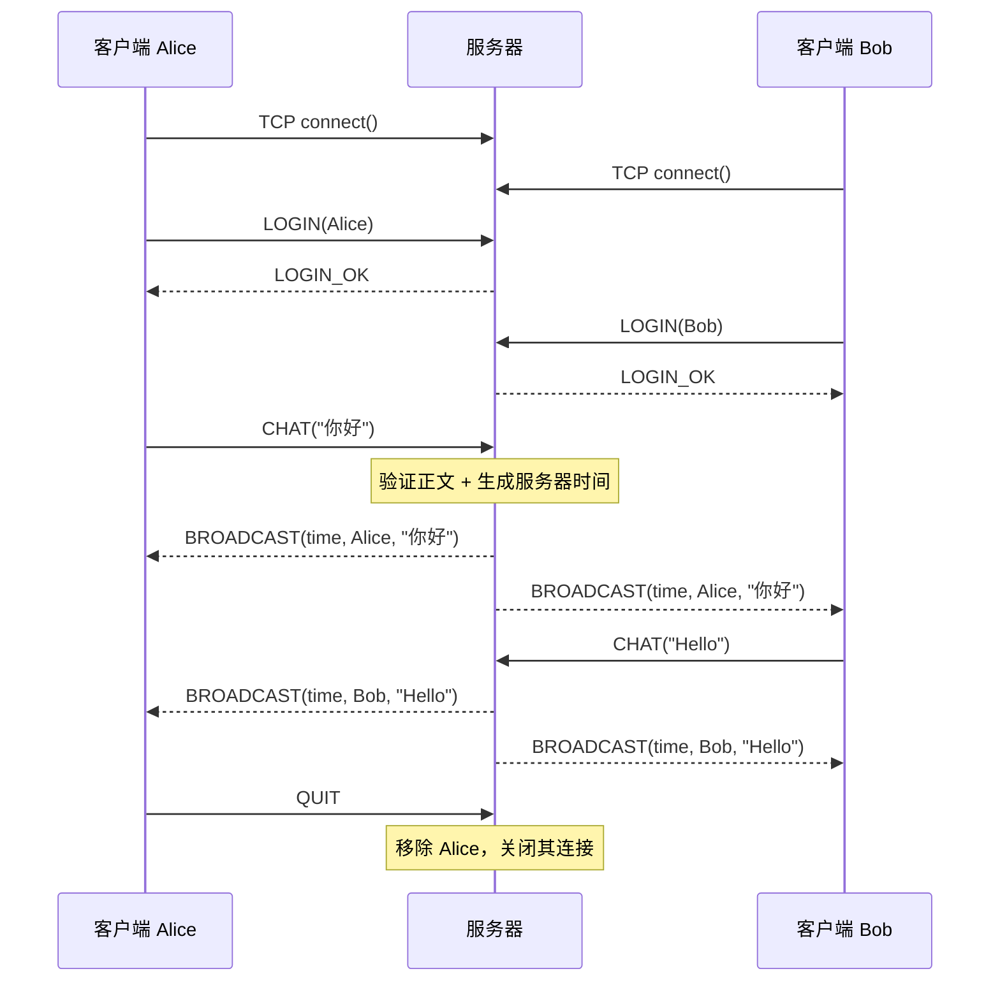
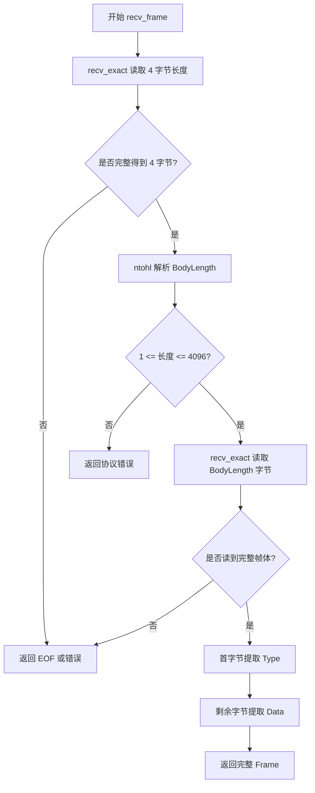

# 计算机网络实验一：TCP Socket 多人聊天室任务实施与验收方案

> **文档定位**：本文件是可直接用于实施的开发方案，而不是前置知识讲义，也不是已经完成的实验报告。先阅读《计算机网络实验一_TCP_Socket聊天室_前置知识.md》，再按本文逐阶段完成代码、验证与报告。
>
> **确定的技术路线**：Linux / WSL Ubuntu + C++17 + POSIX 原生 TCP Socket API + `std::thread` / `std::mutex` + 命令行界面。服务器集中转发消息，每个客户端对应一个服务端工作线程，客户端输入与接收并发。
>
> **范围控制**：实现题目要求的公共聊天室，不增加数据库、账号密码、私聊、文件传输、GUI、网络框架或跨平台兼容层。所有功能都应能通过明确的测试验证。

## 一、从实验要求确定交付目标

### 1. 实验要实现什么

本次实验的输入并不是一批静态数据，而是多个客户端运行过程中不断产生的操作：连接服务器、提交用户名、发送文字、退出聊天室。服务器需要维护一个随连接变化的在线用户集合，并把某个客户端发送的消息转化为带发送者和时间信息的广播消息。

以 Alice 和 Bob 为例，完整路径为：

```text
Alice 在命令行输入“你好”
  → Alice 客户端构造 CHAT 消息帧
  → send() 将字节写入与服务器之间的 TCP 连接
  → 服务器对应工作线程 recv() 并还原完整帧
  → 校验消息合法、取得 Alice 的登录身份
  → 服务器生成时间戳，构造 BROADCAST 消息帧
  → 对所有在线用户的连接分别发送该帧
  → Alice、Bob 客户端的接收线程各自还原帧
  → 终端显示 [时间] Alice: 你好
```

整个过程中，**一个 TCP 连接只负责一个客户端与服务器之间的通信**。服务器收到 Alice 的消息后，是重新向 Bob 的 Socket 发送一份广播，而不是把 Alice 的 TCP 连接转交给 Bob。

### 2. 实验要求与交付物一一对应

| 原实验要求 | 实际要完成的内容 | 可验收的证据 |
| --- | --- | --- |
| （1）流式 Socket、自定义聊天协议、消息带时间 | TCP 通信；定义消息语法、语义、时序；服务器时间戳 | `docs/protocol.md`、抓包、聊天截图 |
| （2）模块划分、功能及流程图 | C/S 架构；客户端、服务端、协议模块；流程/时序图 | `docs/design.md`、Mermaid 图 |
| （3）C/C++，原生 Socket API，给出使用方法 | 使用 `socket/bind/listen/accept/connect/send/recv` 等；命令行参数 | 可编译的源码、`Makefile`、`README.md` |
| （4）支持英文和中文 | 全链路统一 UTF-8，并按字节计算消息长度 | 中英混合聊天测试 |
| （5）多线程、多人聊天 | 服务端多个工作线程；客户端同时输入和接收 | 三客户端并发测试 |
| （6）结构清晰、可读性好 | 文件职责清楚、异常处理明确、少量必要辅助函数 | 代码审查 |
| （7）观察是否有数据包丢失 | 抓取 TCP 数据、查看重传与丢失迹象；对比应用层消息数量 | Wireshark/tcpdump 截图、测试表格 |
| （8）撰写并提交实验报告与源码 | 将设计、实现、运行、测试、分析形成报告 | 源码包与实验报告 |

**完成定义**：服务器可持续服务不少于三个同时在线的客户端；双向多轮聊天正常；每条广播含发送者和时间；中英文正常；单个用户退出或异常断开不影响其他人；能解释和验证 TCP 消息边界、多线程与可靠传输；程序可按 README 复现。

## 二、先确定技术方案与代码边界

### 1. 运行环境

- 开发环境：WSL2 Ubuntu 或原生 Linux。
- 语言标准：C++17。
- 编译器：`g++`，开启警告和线程支持。
- 网络 API：POSIX Socket，使用系统头文件，如 `<sys/socket.h>`、`<arpa/inet.h>`、`<netinet/in.h>`、`<unistd.h>`、`<poll.h>`。
- 并发 API：`std::thread`、`std::mutex`、`std::lock_guard`、`std::atomic`。
- 抓包：优先使用 `tcpdump` 保存 pcap，用 Wireshark 打开分析；也可以直接使用 Wireshark。

不使用封装后的 Socket 类或网络通信框架。**允许**把 `send()` / `recv()` 封装为处理完整字节读写的普通辅助函数，因为这属于基于原生 API 进行必要的应用层协议实现，而不是引入 Socket 框架。

建议先在 WSL 内的多个终端通过 `127.0.0.1` 测试。这里的客户端与服务器位于同一个 Linux 网络环境，最容易调试。功能全部通过后，再考虑使用局域网中的其他机器连接；**跨机器部署不是此题必要条件**。

### 2. 推荐目录结构

```text
ChatRoom/
├── src/
│   ├── protocol.h           # 协议常量、类型、函数声明
│   ├── protocol.cpp         # 完整读写帧、消息编解码、基本校验
│   ├── server.cpp           # 监听、用户管理、线程、广播
│   └── client.cpp           # 连接、登录、终端输入、接收显示
├── tests/
│   └── protocol_probe.py    # 可选的协议边界测试工具，不是聊天室实现
├── docs/
│   ├── protocol.md          # 正式聊天协议说明
│   ├── design.md            # 模块划分、流程图、时序图
│   └── images/              # 运行截图、抓包和测试截图
├── report/
│   └── report.md            # 最终实验报告源文档
├── Makefile
└── README.md
```

`server.cpp` 与 `client.cpp` 各自拥有自己的 `main()`；二者分别编译为 `server` 和 `client`，共享 `protocol.cpp`。无需创建 `Socket`、`Server`、`Client` 等一大套包装类。服务器只需要少量清晰的数据结构和函数。

### 3. 程序运行时的对象及其职责

服务器维护：

- 一个**监听 Socket**：用于 `bind`、`listen`、`accept`，不负责发送聊天消息。
- 每个客户端对应一个**已连接 Socket**：用于与该客户端 `recv` / `send`。
- 一个**在线用户表**：记录用户名与对应连接；只保存登录成功且尚未注销的用户。
- 一个**用户表互斥锁**：保护在线用户表的读取、插入和删除。
- 每个连接自己的**发送互斥锁**：同一个连接不能被多个线程交叉写入不同消息帧。
- 一个**广播互斥锁**：让两次广播的完整分发过程不交叉，保持各接收者看到的广播次序一致。

客户端维护：

- 一个与服务器相连的 TCP Socket。
- 一个接收线程，持续接收并显示广播。
- 主线程处理终端输入及消息发送。
- 一个表示程序仍在运行的标志，用于退出协调。

服务器的**线程数量随连接数量变化**，并非每条消息都新建线程。对于课程实验中的几个客户端，这个模型足够简单且直观。

## 三、正式确定应用层聊天协议

这一步应当**在编写具体聊天逻辑之前完成**。否则客户端与服务器容易对消息长度、字段分隔、时间和异常处理做出不同假设。以下设计与前置知识笔记中的简化协议保持一致，并补全可执行约束。

### 1. 传输单位：消息帧

TCP 只提供字节流，因此应用层必须指定如何从一串字节中拆出完整消息。所有消息统一使用：

```text
        4 字节                     BodyLength 字节
┌──────────────────────────┬───────────────────────────────┐
│ BodyLength (uint32 大端)  │ Type (1 字节) | Data (变长)    │
└──────────────────────────┴───────────────────────────────┘

BodyLength = 1 + Data 的字节数
约束：1 <= BodyLength <= 4096
```

例如发送 `CHAT("Hello!")`：

```text
00 00 00 07 | 03 | 48 65 6C 6C 6F 21
│  长度 7   │类型│       Hello!
```

`BodyLength` 不包含自身的 4 字节；整数使用**网络字节序（大端序）**，发送前使用 `htonl()`，接收后使用 `ntohl()`。所有文本为 UTF-8 字节序列，长度以**字节**计，不以汉字个数计。

接收一帧的固定规则：先精确读取 4 字节长度，检验合法后，再精确读取 `BodyLength` 字节；随后读取首字节作为 `Type`，剩余部分作为 `Data`。任何一次 `recv()` 的返回值都不直接等于“一条消息”。

### 2. 消息类型与字段定义

| 类型值 | 名称 | 允许方向 | Data 结构 | 处理语义 |
| --- | --- | --- | --- | --- |
| `0x01` | `LOGIN` | 客户端 → 服务器 | UTF-8 用户名 | 请求设置连接身份 |
| `0x02` | `LOGIN_OK` | 服务器 → 客户端 | 空 | 登录成功，可进入聊天 |
| `0x03` | `CHAT` | 客户端 → 服务器 | UTF-8 正文 | 请求服务器向在线用户广播 |
| `0x04` | `BROADCAST` | 服务器 → 客户端 | 时间、用户名、正文 | 向客户端展示聊天信息 |
| `0x05` | `QUIT` | 客户端 → 服务器 | 空 | 请求退出聊天室 |
| `0x06` | `ERROR` | 服务器 → 客户端 | UTF-8 错误说明 | 拒绝无效请求，随后断开 |

`LOGIN_OK` 和 `QUIT` 的 `BodyLength` 必须为 `1`；其 Data 不允许额外字段。服务器收到客户端伪造的 `LOGIN_OK`、`BROADCAST` 或 `ERROR`，视作协议错误。

**字段限制（本实验固定值）**：

- 用户名长度：`1～32` 字节；UTF-8 合法；不得含 `\0`、回车、换行及其他控制字符；同一时刻不能与在线用户名重复。用户名比较按原始 UTF-8 字节串进行，不额外做大小写折叠或 Unicode 归一化。
- `CHAT` 正文长度：`1～4000` 字节；UTF-8 合法；不得含 `\0`；正文可含换行，但基本命令行界面每次输入的是单行内容。
- `ERROR`：简短 UTF-8 文本，例如 `username already in use`、`invalid message`。协议错误统一在尽可能发送一次 `ERROR` 后关闭连接；若消息长度字段本身非法或连接已不可写，则直接关闭。
- `BROADCAST`：总帧长度仍受 `4096` 字节限制。采用 4000 字节的聊天正文上限，配合最长 32 字节用户名和固定长度时间戳，不会超出总上限。

**推荐时间字段和广播正文**：

```text
BROADCAST.Data = YYYY-MM-DD HH:MM:SS\n用户名\n消息正文
```

其中，时间占**固定的 19 个 ASCII 字节**，由服务器在处理 `CHAT` 时获取；采用服务器本地时间，实际时区须在报告中注明。用户名不允许换行，因此客户端只按前两个 `\n` 分割出时间、用户名，余下的字节均为正文，不会因为正文包含换行而误拆字段。

例如：

```text
Type: 0x04
Data (UTF-8):
2026-10-20 16:30:05
Alice
你好，Hello!
```

广播包含原发送者和其他全部当前在线用户。客户端发送 `CHAT` 后**不自行伪造一条成功的聊天显示**，而是等待服务器返回的 `BROADCAST`；这样显示的身份与时间始终由服务器决定。

### 3. 协议的语义和应用状态

TCP `connect()` 成功，只代表网络连接建立，不代表聊天室登录。服务端为每个客户端维护以下逻辑状态：

```text
CONNECTED（已建立 TCP 连接，未登录）
    │ 收到合法 LOGIN、用户名不重复
    ▼
LOGGED_IN（已登录，已进入在线用户表）
    ├── CHAT ──→ 校验正文 → 添加时间/身份 → BROADCAST → 保持 LOGGED_IN
    ├── QUIT ──→ 从用户表移除 → 关闭连接
    ├── EOF/网络错误 ──→ 从用户表移除 → 关闭连接
    └── 协议错误 ──→ ERROR（能发送时）→ 清理并关闭连接

CONNECTED 收到非 LOGIN：ERROR → 关闭连接
CONNECTED 收到无效 LOGIN：ERROR → 关闭连接
```

**关键原则**：用户名只能通过第一次合法 `LOGIN` 设置。`CHAT` 消息中不携带发送者名，服务器必须使用该 Socket 对应的已登录身份，避免客户端冒充其他人。

### 4. 必须写入 `docs/protocol.md` 的交互时序



说明：这张图描述应用层顺序，不重复绘制 TCP 三次握手和 TCP 的 ACK。若某消息不合法，服务器可以返回 `ERROR` 并断开；若一方意外断线，对端收到 EOF/套接字错误后清理连接。

### 5. 异常处理策略应在协议阶段固定

| 条件 | 服务端动作 | 客户端预期 |
| --- | --- | --- |
| `LOGIN` 合法且用户名未占用 | 登记用户，发送 `LOGIN_OK` | 进入聊天界面 |
| 用户名重复或非法 | 发送 `ERROR`，关闭连接 | 显示失败原因并退出 |
| 未登录直接发送 `CHAT` | `ERROR`，关闭连接 | 不应将消息显示为成功发送 |
| 收到未知类型或不允许的方向 | `ERROR`，关闭连接 | 显示错误或断线 |
| 长度为 0 或大于 4096 | 不继续读取负载，关闭连接 | 显示连接中断 |
| 对端在帧中途断开 | 将其判定为不完整帧，清理连接 | 不展示不完整的聊天消息 |
| 合法 `CHAT` | 生成广播，发送给所有当前在线用户 | 看到服务器生成的时间与身份 |
| 合法 `QUIT` | 注销用户并关闭连接 | 正常退出 |
| `send()` 失败或连接复位 | 记录错误并清理对应连接 | 其他用户继续工作 |

对于偶发错误与中断：`send()`、`recv()` 遇到 `EINTR` 可重试；对端正常关闭表现为 `recv()` 返回 `0`。不要写成“任何一次 `recv()` 返回不足预期长度都代表错误”。

## 四、模块实现细化：每个文件具体写什么

### 1. `protocol.h` / `protocol.cpp`：协议与完整帧收发

这个模块必须独立于用户名列表、广播和终端输入。它只负责在 TCP 连接上准确传输一帧，以及把某些字节解释为协议消息。

建议定义：

```cpp
enum class MessageType : std::uint8_t {
    LOGIN = 0x01,
    LOGIN_OK = 0x02,
    CHAT = 0x03,
    BROADCAST = 0x04,
    QUIT = 0x05,
    ERROR = 0x06,
};

constexpr std::uint32_t MAX_BODY_BYTES = 4096;
constexpr std::size_t MAX_USERNAME_BYTES = 32;
constexpr std::size_t MAX_CHAT_BYTES = 4000;

struct Frame {
    MessageType type;
    std::string data;    // 原始 UTF-8 字节序列
};
```

协议辅助函数至少完成：

1. `send_all(fd, bytes, length)`：反复调用原生 `send()`，直到指定长度全部成功发送或出现不可恢复错误。Linux 下可以对 `send` 使用 `MSG_NOSIGNAL`，避免对端关闭连接导致进程因 `SIGPIPE` 直接终止。
2. `recv_exact(fd, buffer, length)`：反复调用原生 `recv()`，直到得到指定字节数；明确区分**正常读到 EOF、完整接收、帧中途断开、系统调用错误**。
3. `send_frame(fd, Frame)`：先构造完整的 `4 字节长度 + 1 字节类型 + Data`，然后由调用方保证同一连接的整帧写入不会与其他发送交叉。
4. `recv_frame(fd)`：读取长度、校验上限、读取帧体、返回 `Frame` 或结构化读失败结果。
5. `make_broadcast_data(timestamp, username, content)` 和相应解析函数：按前两个换行符组装/拆分字段。
6. `valid_username()` / `valid_chat()`：执行前述字段约束；若声明 UTF-8 合法性校验，则实现真正的 UTF-8 校验，不能仅凭“字节串不为空”视为有效。

`send_all` / `recv_exact` **不参与线程调度**，也不替业务逻辑维护在线用户。它们只对指定 Socket 做完整字节收发。

一帧的接收流程：



必须注意：**长度上限先检查，内存后分配**。不要在尚未检查 `BodyLength` 的情况下依据外部输入分配巨大缓冲区。

### 2. `server.cpp`：服务端连接管理与消息广播

服务器主要函数可以是：

```text
main
  ├── parse_server_args              # 解析监听端口
  ├── create_listen_socket            # socket / setsockopt / bind / listen
  ├── accept_loop                     # 等待多个客户端接入
  │     └── 创建一个工作线程 handle_client
  ├── handle_client                   # 每个客户端的唯一接收线程
  │     ├── 读取 LOGIN，执行用户名检查
  │     ├── 完成登录登记和 LOGIN_OK
  │     ├── 循环 recv_frame
  │     ├── CHAT → broadcast_chat
  │     └── QUIT/错误/EOF → cleanup_client
  ├── broadcast_chat                  # 构造时间 + 用户名 + 正文
  └── shutdown_server                 # 停止监听、唤醒线程、回收资源
```

`create_listen_socket()` 的核心调用顺序：

```cpp
int listen_fd = socket(AF_INET, SOCK_STREAM, 0);
// 检查 listen_fd >= 0
// setsockopt(listen_fd, SOL_SOCKET, SO_REUSEADDR, ...)
// sockaddr_in: AF_INET、htons(port)、INADDR_ANY
bind(listen_fd, ...);
listen(listen_fd, SOMAXCONN);
```

`bind`、`listen` 任一步失败，都应打印 `errno` 对应错误并终止启动。`SO_REUSEADDR` 可用于降低开发时重启服务端遇到地址占用的影响，但不代表可以同时运行两个服务端监听相同地址端口。

**线程模型**：监听线程调用 `accept()` 取得 `client_fd`，为该连接创建一条工作线程，随后立即返回继续接收新连接。工作线程才负责该 `client_fd` 的 `LOGIN`、`CHAT` 与 `QUIT`。不要在监听线程中执行永久的 `recv_frame(client_fd)`，否则服务器会被单个客户端阻塞。

推荐最小的数据结构：

```cpp
struct ClientSession {
    int fd;
    std::string username;
    std::mutex send_mutex;
    bool active = true;  // 只在 send_mutex 保护下读写
};

std::mutex users_mutex;
std::mutex broadcast_mutex;
std::unordered_map<std::string, std::shared_ptr<ClientSession>> users;
```

同一个 `ClientSession` 可通过 `std::shared_ptr` 临时保存在广播接收者快照中，保证其他线程正在引用连接状态时对象本身不提前销毁。不要把 `shared_ptr` 理解成“Socket 可以任意时候关闭”：**真正关闭 `fd` 仍必须由明确的拥有者负责，并与发送同步。**

**登录时序细节**：登录成功时，必须避免广播比 `LOGIN_OK` 更早写到该连接。可在注册该会话并发送 `LOGIN_OK` 的短暂阶段持有此会话的 `send_mutex`；检查用户名和插入用户表时短暂持有 `users_mutex`，完成后释放用户表锁，再发送 `LOGIN_OK`，最后释放发送锁。其他广播即使已经把新用户纳入快照，也会等待该会话的发送锁，不会抢在 `LOGIN_OK` 前写入。

### 3. 服务器广播如何同时保证正确性与并发安全

收到某用户的合法 `CHAT` 后，建议按以下顺序操作：

1. 从当前工作线程对应的会话取得**已登录用户名**，不相信正文里的任何伪造身份。
2. 在服务器侧获取当前本地时间，格式化为 `YYYY-MM-DD HH:MM:SS`。
3. 构造 `BROADCAST` 帧，并检查编码后的长度未超过 4096。
4. 持有 `broadcast_mutex`，避免两个广播分别对不同客户端产生交错的发送顺序。
5. 短暂获取 `users_mutex`，复制 `shared_ptr<ClientSession>` 到接收者列表，然后立即释放用户表锁。
6. 遍历快照：对每个接收者获取其 `send_mutex`，检查 `active`，通过 `send_frame` 完整发送；释放发送锁。**不要在发送网络数据期间持有 `users_mutex`**。
7. 遇到发送失败的接收者，将该连接标记为待断开并用 `shutdown(fd, SHUT_RDWR)` 通知其所属工作线程结束接收；**不要在其他线程直接 `close(fd)`**，避免关闭/复用文件描述符的竞争。
8. 其所属工作线程收到错误/EOF 后，将会话从在线表中删除，并在不再有发送使用者时关闭 Socket。

实际实现时应避免反向锁依赖：网络发送不在 `users_mutex` 内进行，清理过程也不能在等待 `send_mutex` 时继续占有用户表锁；否则两个线程容易形成死锁。

这一设计偏向课程实验规模。为了避免某个不读取消息的慢客户端无限阻塞所有广播，建议为已连接 Socket 设置一个合理的**发送超时**（例如 `SO_SNDTIMEO` 约 3 秒），超时则按发送失败清理该用户。无需引入异步 I/O 框架来解决。

### 4. `client.cpp`：登录、输入与接收分离

客户端启动命令设为：

```bash
./client 127.0.0.1 8888 Alice
```

客户端应先在主线程完成：创建 Socket、解析 IP 和端口、`connect()`、发送 `LOGIN`、接收并验证 `LOGIN_OK`。**登录成功之前不要启动第二个 Socket 读取者**。

登录成功后：

- **主线程**：等待键盘输入，非空普通文字发送 `CHAT`；输入 `/quit` 发送 `QUIT` 并离开；输入 EOF（Ctrl+D）也退出。
- **接收线程**：唯一负责 `recv_frame()`；收到 `BROADCAST` 就解析并输出；收到 `ERROR`、EOF 或网络错误时通知主线程退出。

线程退出是一个容易遗漏的问题。接收线程检测到连接关闭后，可以设置 `running = false`。但如果主线程一直阻塞在 `std::getline()`，它可能看不到这个标志。因此 Linux 命令行版本建议使用 `poll(STDIN_FILENO, ...)` 配合短超时（如 200 ms）等待终端可读，在超时间隙检查 `running`，而不是永久阻塞等键盘输入。

本次实现中，一个客户端仅由主线程发送普通 `CHAT`/`QUIT`，接收线程只读取，不需要客户端两个线程同时调用 `send()`。退出时由主线程执行 `shutdown(fd, SHUT_RDWR)` 使可能阻塞的接收线程返回，再 `join()`，最后仅关闭一次 Socket。

### 5. 服务端线程回收与停止流程

只写“每接入一个用户就 `std::thread(...).detach()`”虽然容易，但难以在服务器停止时明确管理工作线程。本实验建议**明确管理线程生命周期**：

- 主线程持有 `std::vector<std::thread>`，每接入一个用户就添加工作线程；工作线程完成后保持可 `join` 状态。
- 为便于实现简洁的优雅退出，监听线程使用 `poll()` 在监听 Socket 上等待可接入事件（如 200 ms），定期检查停止标志；若采用 Ctrl+C，信号处理函数只设置 `volatile sig_atomic_t` 类型的停止标志，不能在信号处理器内做日志输出、加锁或复杂清理。
- 停止阶段：不再接收新用户 → 关闭监听 Socket → 获取当前用户快照 → 对活动连接调用 `shutdown()` 唤醒其阻塞的 `recv()` → `join` 全部工作线程 → 结束进程。
- 每个连接的最终 `close(client_fd)` 由**对应工作线程**执行一次。清理时先从在线用户表移除，再在会话发送锁保护下标记 `active=false` 并关闭自身 Socket，保证广播线程不再继续使用该描述符。
- `users_mutex` 不得在阻塞 `send()` 或等待线程 `join()` 时被长期持有。

课程实验客户端数量较少，保留已结束线程对象直到服务端退出是可接受的。这里没有必要额外实现线程池或线程回收器；如果将来要支持长期在线的大规模用户，再调整为线程池或事件驱动架构。

## 五、正式编码：按可验证的阶段逐步完成

每个阶段的要求都是“**实现 → 编译 → 运行 → 验收 → 才进入下一阶段**”。不要把所有功能一次性混在一起写完再尝试运行。

### 阶段 0：项目初始化与环境确认

**要做什么**：创建目录、编译规则、README 初稿，确保 `g++` 和基本 Linux 命令正常工作。

```bash
# 在项目根目录执行
mkdir -p ChatRoom/{src,tests,docs/images,report}
cd ChatRoom

g++ --version
make --version
```

如果没有编译工具，可安装：

```bash
sudo apt update
sudo apt install -y build-essential make
```

建议 `Makefile` 至少提供 `all`、`server`、`client`、`clean` 目标，编译参数包含：

```bash
g++ -std=c++17 -O2 -Wall -Wextra -Wpedantic -pthread \
    src/server.cpp src/protocol.cpp -o server

g++ -std=c++17 -O2 -Wall -Wextra -Wpedantic -pthread \
    src/client.cpp src/protocol.cpp -o client
```

**验收**：`make` 可以构建两个独立可执行文件；`make clean` 可以删除构建产物；编译器警告为零或每一条都已明确处理。

> 阶段 0 时业务文件还未写完，可先建立最小的 `main()` 占位实现。后续再逐步填充，不必提前构造复杂空架构。

### 阶段 1：完成单客户端 TCP 连通性

**目标**：先排除 IP、端口、Socket 调用顺序等问题，此时还不写完整聊天协议、不引入多线程。

服务端按以下步骤实现：

1. 从命令行获取监听端口，例如 `8888`，检查是否位于 `1～65535`。
2. `socket(AF_INET, SOCK_STREAM, 0)` 创建 IPv4 TCP 监听 Socket。
3. 设置 `SO_REUSEADDR`，准备 `sockaddr_in`；`sin_family=AF_INET`，`sin_port=htons(8888)`，`sin_addr.s_addr=htonl(INADDR_ANY)`。
4. `bind()` 指定本机端口；`listen()` 进入监听状态。
5. `accept()` 取得 `client_fd`，打印客户端已连接。
6. 对 `client_fd` 执行一次基本 `recv()`，把收到的内容回显到客户端。
7. 清理两个 Socket 并退出。

客户端按以下步骤实现：

1. 从参数获取服务器 IP、端口；用 `inet_pton(AF_INET, ...)` 解析 IPv4 地址。
2. `socket()` 后用 `connect()` 建立连接。
3. 发送简单测试字节串，例如 `Hello TCP`。
4. 用 `recv()` 获取服务器回显并显示。
5. 关闭连接退出。

**此阶段刻意只验证原生 Socket 链路**，不要把简单回显理解为最终协议。待阶段 2 完成后，回显逻辑将被完整消息帧替换。

**运行验收**：分别打开两个 WSL 终端。服务器先执行 `./server 8888`，客户端后执行 `./client 127.0.0.1 8888 Alice`（此阶段可以暂时忽略用户名参数）。服务器看到连接，客户端能收到回显，退出无异常。

**失败定位**：

- `Connection refused`：通常是服务端未监听该 IP/端口。
- `Address already in use`：端口已被占用；检查是否存在旧服务端进程。
- `bind()` 失败：检查地址与端口设置、返回值以及 `errno`。
- 没有数据显示：检查服务端是否真的在对 `accept()` 返回的 `client_fd` 进行接收。

### 阶段 2：实现可靠的应用层消息帧收发

**目标**：处理 TCP 无消息边界的问题；通过本阶段后，后面的登录、广播只需要关注 `Frame` 而不需要重复处理零散字节。

在 `protocol.cpp` 实现：

1. `send_all`：循环发送未传完的字节，推进偏移量；对 `EINTR` 重试；`send` 返回失败时带错误状态返回。
2. `recv_exact`：循环接收剩余字节；严格区分完整收取、对端关闭和中途不完整帧。
3. `send_frame`：检查 Data 和类型；计算 `BodyLength`；`htonl`；构造完整帧；调用 `send_all`。
4. `recv_frame`：先读取 4 字节长度，再读取帧体；解析 Type 与 Data。
5. 编写简单的协议帧自测：连续发送两帧、一次只发部分帧、中文 UTF-8 正文、超大长度、对端中途断开。

**验收条件**：

- 发送一次 `CHAT("Hello!")`，能看到网络字节以 `00 00 00 07 03 ...` 开头。
- 两帧连在同一次底层发送中，接收方仍解析为两条消息。
- 一帧拆分成多个底层发送，接收方仍能得到一条完整消息。
- `BodyLength > 4096` 时，不按该长度分配内存、不继续等待巨量字节。
- 发送一个汉字时，按 UTF-8 的实际字节数计入长度。

**本阶段不需要实现多用户**。这能把“协议解析错误”和“并发竞态”隔离开。

### 阶段 3：实现登录状态与带时间的双向聊天

**目标**：一个客户端能登录、发送 `CHAT`、收到服务器构造的 `BROADCAST`，并主动 `QUIT`。

服务端：

1. `accept` 后建立会话状态 `CONNECTED`。
2. 用 `recv_frame` 等待首条消息，要求它必须是合法 `LOGIN`。
3. 检查用户名格式、字节上限、是否重复；合法才登记在线用户，并发回 `LOGIN_OK`。
4. 进入 `LOGGED_IN`，循环读取 `CHAT` 或 `QUIT`。
5. 对每条 `CHAT`：获取服务器本地时间，按协议生成 `BROADCAST`，发回当前客户端。
6. 对 `QUIT`：退出接收循环，注销并关闭连接。

客户端：

1. 完成 TCP `connect()`，发 `LOGIN(username)`。
2. 读取 `LOGIN_OK` / `ERROR`；未成功则不进入聊天界面。
3. 用户输入普通文本，编码为 `CHAT`；收到 `BROADCAST` 后显示 `[YYYY-MM-DD HH:MM:SS] username: text`。
4. 用户输入 `/quit`，发送 `QUIT` 并退出。

时间由**服务器**生成，客户端不自行填充时间。聊天发送者也由服务器依据登录会话确定。

**验收**：

```text
服务器： ./server 8888
客户端： ./client 127.0.0.1 8888 Alice

Alice> 你好，Hello!
[2026-10-20 16:30:05] Alice: 你好，Hello!
Alice> /quit
Disconnected.
```

上例是期望显示效果，时间以测试时服务器实际时间为准。

### 阶段 4：引入多线程与多人广播

**目标**：从“一个客户端能聊天”扩展为“多个客户端彼此通过服务器聊天”。

服务端修改：

1. 监听主线程不再直接执行完整聊天循环，而是每次 `accept()` 成功后创建一个 `handle_client` 工作线程。
2. 在线用户表与 `users_mutex` 配套使用，确保两个客户端同时登录相同用户名时，只有一个能成功。
3. 每个会话有独立 `send_mutex`，任何向此会话发送完整帧的操作，都必须遵守同一互斥规则。
4. `broadcast_chat` 生成用户快照，然后给包括发送者在内的所有已登录用户发送同一条广播。
5. 对每个断线用户及时移除在线记录，避免用户名长期被占用或向已断开的 Socket 继续发送。
6. 保持线程资源归属清晰：工作线程读与最终关闭自己的客户端 Socket；其他线程只允许在约定锁和生命周期内发送、标记失效、`shutdown`。

客户端修改：

1. 登录完成后启动单独接收线程，持续 `recv_frame()` 并输出。
2. 主线程持续读取终端输入并发送 `CHAT`。
3. 通过停止标志和 `shutdown` / `join` 协调退出。
4. 退出后确保没有后台线程继续访问已经关闭的文件描述符。

**多人验收场景**：同一 WSL 内打开四个终端，一个启动服务器，另外三个分别登录 Alice、Bob、Charlie。Alice 输入中文，Bob 输入英文，Charlie 输入混合文本；三方都应看到广播。Bob 主动退出后，Alice 和 Charlie 继续双向聊天，服务器保持运行。

**并发验收场景**：Alice、Bob 短时间内连续发送多条消息，所有在线用户收到的每条广播都应具备完整时间、正确用户名及完整正文，不应出现半条消息、用户名错位或字符乱码。

### 阶段 5：完善协议错误与生命周期处理

**目标**：让程序不仅“正常路径可用”，异常路径也有明确行为。

优先按以下顺序补齐：

1. **错误用户名**：空用户名、超长用户名、重复用户名、含控制字符。
2. **非法消息帧**：`BodyLength=0`、`BodyLength=4097`、未知类型、`LOGIN_OK` 方向错误、正文超过限制。
3. **不完整帧**：只发送 4 字节长度和部分消息体就断开；服务器必须退出对应线程，不得一直等待。
4. **网络中断**：客户端进程被终止，服务器清理用户；不影响其他客户端。
5. **退出流程**：客户端 `/quit`、Ctrl+D；服务端 Ctrl+C；确保 Socket 不重复关闭、线程能结束。
6. **慢客户端处理**：对端不读取时避免无界阻塞，采用发送超时或约定的失败处理。

重点排查：线程竞态、互斥锁顺序、向已关闭 `fd` 发送、工作线程退出但用户表未清理、终端输入线程无法结束、重复发送同一条广播。

**验收**：至少连续运行多轮“进入 → 发送 → 退出 → 重新使用相同用户名进入”，没有死锁、崩溃或用户名误占用。

### 阶段 6：进行系统性功能测试与抓包观察

测试应该分为**功能正确性**与**TCP 传输现象**两个层面，不能把二者混为一谈。

#### 6.1 功能测试清单

| 编号 | 测试操作 | 预期结果 |
| --- | --- | --- |
| T01 | 服务端以有效端口启动 | 正常监听，输出监听地址和端口 |
| T02 | 客户端输入正确 IP、端口、用户名 | 登录成功并能聊天 |
| T03 | 两客户端中英混合聊天 | 文字无乱码，显示服务器时间和真实发送者 |
| T04 | 三客户端同时在线 | 任一客户端消息被广播到三个客户端（包含自己） |
| T05 | 两人快速连续发送多条消息 | 消息不截断、不合并、不交叉，来源正确 |
| T06 | 同一用户名前后重复登录 | 同时在线不能重名，退出后可复用 |
| T07 | 单客户端 `/quit` | 仅该用户退出，其他人仍可聊天 |
| T08 | 客户端突然终止 | 服务器清理该连接，其余用户不受影响 |
| T09 | 不合法帧长度和未知类型 | 拒绝并关闭异常连接，不崩溃 |
| T10 | 发送拆分帧或连续帧 | 接收端准确识别每一帧 |
| T11 | 无效 IP、端口、服务器不在线 | 有明确的连接失败提示，不崩溃 |
| T12 | 服务端 Ctrl+C | 停止监听，结束工作线程，释放资源 |

建议报告里对关键测试各记录一次：**测试输入、观察结果、结论、截图编号**；不必为完全相同的成功场景重复放十几张图。

#### 6.2 测试消息边界：使用一个很小的外部测试工具

正式聊天程序必须用 C/C++ 原生 Socket 实现，但**测试辅助脚本**可以用 Python 构造特定字节序列，以检查 C++ 服务端是否真正按协议处理拆分帧与连续帧。这不是用 Python 代写聊天室。

以下脚本可保存为 `tests/protocol_probe.py`。运行前先启动服务端 `./server 8888`：

```python
import socket
import struct
import time

HOST, PORT = "127.0.0.1", 8888


def make_frame(message_type: int, content: bytes = b"") -> bytes:
    body = bytes([message_type]) + content
    return struct.pack("!I", len(body)) + body


def read_exact(sock: socket.socket, count: int) -> bytes:
    result = bytearray()
    while len(result) < count:
        part = sock.recv(count - len(result))
        if not part:
            raise EOFError("peer closed before full frame")
        result.extend(part)
    return bytes(result)


def read_frame(sock: socket.socket) -> bytes:
    size = struct.unpack("!I", read_exact(sock, 4))[0]
    assert 1 <= size <= 4096
    return read_exact(sock, size)


with socket.create_connection((HOST, PORT), timeout=3) as sock:
    sock.settimeout(3)

    # 故意把同一 LOGIN 帧拆成三次 TCP 写入
    login = make_frame(0x01, b"ProtocolProbe")
    for part in (login[:2], login[2:6], login[6:]):
        sock.sendall(part)
        time.sleep(0.05)
    assert read_frame(sock) == b"\x02", "LOGIN_OK not received"

    # 故意把两个 CHAT 帧连接到一次 sendall 中
    sock.sendall(
        make_frame(0x03, "Hello".encode("utf-8"))
        + make_frame(0x03, "你好".encode("utf-8"))
    )
    first = read_frame(sock)
    second = read_frame(sock)
    assert first[0] == second[0] == 0x04
    assert b"Hello" in first
    assert "你好".encode("utf-8") in second

    sock.sendall(make_frame(0x05))

print("protocol fragmentation/coalescing test PASSED")
```

```bash
python3 tests/protocol_probe.py
```

此脚本验证的是**应用层分帧能力**：拆为多次 `sendall` 并不意味着一定产生多个网络层 IP 包；两帧在同一次 `sendall` 发送也不保证只对应一个 TCP 数据段。严谨表述应是“协议对任意分段/合并的字节流都能够正确还原消息”。

#### 6.3 Wireshark / tcpdump 观察数据包与 TCP 重传

首先在本机回环网络上执行功能测试并保存抓包：

```bash
# 检查是否有 tcpdump
command -v tcpdump

# 若没有，可安装
sudo apt install -y tcpdump

# 服务器运行时，在新的 WSL 终端执行
sudo tcpdump -i lo -s 0 -w docs/images/chat-loopback.pcap 'tcp port 8888'
```

随后在其他终端运行 Alice、Bob 客户端，发送几条中英文消息，退出后使用 Ctrl+C 停止抓包。在 Wireshark 中打开 `chat-loopback.pcap`，过滤表达式：

```text
tcp.port == 8888
```

重点观察三类信息：

1. **TCP 连接建立**：SYN、SYN/ACK、ACK，用于说明客户端的 `connect()` 与服务端 `accept()` 背后的连接建立过程。
2. **应用数据**：观察携带数据的 TCP 段、Follow TCP Stream，以及自定义帧的 4 字节长度/1 字节 Type。它可能跨多个 TCP 段，不能假设一个 `send()` 对应一个独立数据包。
3. **重传与异常**：使用 `tcp.analysis.retransmission` 等过滤项查看 Wireshark 标出的重传迹象，并结合 TCP 序号和 ACK 分析是否真的存在网络传输问题。抓包工具提示并不等价于应用层聊天消息丢失。

**关于实验要求（7）的正确结论**：

- 在稳定的本机回环链路上，**未观察到重传是很常见的结果**。这是有效的实验观察，不需要为了“必须有丢包”而伪造结果。
- TCP 具有确认与重传机制；底层数据段可能丢失，但最终应用层通过 `recv()` 仍能完整获得可靠字节流。
- 应用层应另外通过消息编号/日志或发送接收数量对比，确认聊天程序没有**因为自身并发、解析或异常处理错误**丢失消息。
- 如果需要研究故意制造网络丢包，可在**可控的虚拟网络接口/网络命名空间**上使用 `tc netem` 模拟；这是可选扩展，不建议直接改变 WSL 日常网络接口配置，更不能把对网络层的限制误认为聊天室协议提供的功能。

抓包文件用于分析，截图可放入 `docs/images/`。如果提交平台限制体积，报告保留关键截图和分析，不必提交完整 pcap。

### 阶段 7：整理源码、说明文档与实验报告

到这一步功能与测试应已完成，报告不能倒过来凭空写预期结果。按下文结构整理材料，确保每个实验要求有对应说明与证据。

## 六、服务端与客户端的完整运行逻辑

本节给出**方案伪代码**。它不是可以直接编译的源码，但应作为之后实现和代码审查的逻辑基准。正式代码可以调整函数名，不应改变重要的执行顺序与并发不变量。

### 1. 服务器主流程伪代码

```text
输入：监听端口 port
初始化：running = true，在线用户表 users = 空
创建监听 Socket
设置 SO_REUSEADDR
bind(port)；listen()

while running:
    用 poll 检查监听 Socket（有限超时，允许响应退出）
    if 可接受新连接:
        client_fd = accept(listen_fd)
        if 失败: 按 errno 决定记录错误/继续
        为 client_fd 创建 ClientSession
        为该会话创建 handle_client 工作线程，并保存线程句柄

停止接入：关闭 listen_fd
获取在线会话快照，逐一 shutdown(fd) 唤醒工作线程
join 所有工作线程
输出服务端停止信息
```

### 2. 单个客户端服务线程伪代码

```text
输入：session（含 client_fd、发送锁、生命周期状态）
状态：CONNECTED

frame = recv_frame(client_fd)
若读取失败：转 CLEANUP
若不是合法 LOGIN：尽可能发送 ERROR；转 CLEANUP
检查用户名格式；与在线表中现有用户名查重
若不合法或重复：尽可能发送 ERROR；转 CLEANUP

在保证 LOGIN_OK 先于广播发往此会话的同步下：
    将 session 添加到在线用户表
    向 session 发送 LOGIN_OK
    若发送失败：转 CLEANUP
状态 = LOGGED_IN

while 服务端未停止:
    frame = recv_frame(client_fd)
    若 EOF/错误：退出循环

    if frame.type == CHAT:
        若正文无效：尽可能发送 ERROR；退出循环
        timestamp = server_local_time()
        out_frame = BROADCAST(timestamp + '\n' + username + '\n' + content)
        broadcast(out_frame)

    else if frame.type == QUIT 且 Data 为空:
        退出循环

    else:
        尽可能发送 ERROR
        退出循环

CLEANUP:
    在用户表互斥保护下移除本 session
    与发送线程协调，标记 inactive 并关闭本工作线程拥有的 fd
    退出线程
```

### 3. 广播模块伪代码

```text
输入：完整的 BROADCAST 帧

获取 broadcast_mutex
    获取 users_mutex
        recipients = 复制当前在线 Session 的 shared_ptr 列表
    释放 users_mutex

    for recipient in recipients:
        获取 recipient.send_mutex
            if recipient.active:
                result = send_frame(recipient.fd, frame)
                if 失败:
                    标记连接失效/请求其工作线程退出
        释放 recipient.send_mutex
释放 broadcast_mutex

返回
```

**锁顺序说明**：用户表锁只保护用户表操作；永远不要在持有它的情况下执行阻塞发送或等待工作线程。要把会话指针先复制出来，后续每个目标 Socket 的具体发送在其发送锁保护下完成。

### 4. 客户端主流程伪代码

```text
输入：server_ip、port、username
校验参数
client_fd = socket(AF_INET, SOCK_STREAM, 0)
connect(client_fd, server_address)
发送 LOGIN(username)
frame = recv_frame(client_fd)
若不是 LOGIN_OK：显示失败原因、关闭连接并退出

running = true
启动 receiver_thread：
    while running:
        frame = recv_frame(client_fd)
        if frame 为 BROADCAST:
            解析时间、用户名、正文并输出
        else if frame 为 ERROR:
            输出错误并结束
        else if EOF/网络错误:
            输出断线提示并结束
    running = false

主线程：
    while running:
        使用 poll 等待终端输入，超时后重新检查 running
        若读到 EOF：退出循环
        若输入 == "/quit"：尝试发送 QUIT；退出循环
        若输入为空：继续
        否则：校验 UTF-8/字节上限，发送 CHAT
        若发送失败：退出循环

running = false
shutdown(client_fd) 以唤醒可能阻塞的 receiver_thread
join(receiver_thread)
close(client_fd)
退出
```

### 5. 两个特别重要的不变量

1. **每个 TCP 连接只有一个线程读取帧。** 客户端登录确认在主线程读取，接收线程启动后，主线程不再调用 `recv()`；服务器上，每条已连接 Socket 只由所属工作线程读取。
2. **同一个 TCP 连接的完整帧发送不能互相穿插。** 多个服务端工作线程可能同时需要广播给 Bob，因此给 Bob 发送一帧的所有字节必须由同一把 `send_mutex` 保护，不能只给长度字段或一次 `send()` 调用单独加锁。

这两个不变量是避免“聊天消息偶尔乱码、字段错位、两条消息互相混杂”的主要保障。

## 七、README 与实验报告如何编写

### 1. `README.md` 必须给出可复现操作

推荐至少写明：

```bash
# 环境：Ubuntu / WSL Ubuntu，已安装 g++、make
make

# 终端 1：启动服务器
./server 8888

# 终端 2：用户 Alice
./client 127.0.0.1 8888 Alice

# 终端 3：用户 Bob
./client 127.0.0.1 8888 Bob

# 终端 4：用户 Charlie
./client 127.0.0.1 8888 Charlie

# 客户端输入消息后回车发送；输入 /quit 退出
# 服务端按 Ctrl+C 停止

make clean
```

说明默认编码 UTF-8、端口有效范围、服务器和客户端参数含义、可使用的退出命令，以及典型运行效果。启动报错需输出清晰原因（例如监听失败、连接失败、用户名冲突）。

### 2. `docs/protocol.md` 最少要包含什么

不要只有“本实验使用 TCP 协议”这样一句话；题目明确要求自定义的**交互消息语法、语义、时序**。此文档至少包括：

- 帧字节布局：4 字节大端 `BodyLength`、1 字节 Type、Data；最大长度。
- 消息类型表：LOGIN / LOGIN_OK / CHAT / BROADCAST / QUIT / ERROR；字段格式与合法方向。
- 编码规则：UTF-8、字节长度、时间的格式及时区。
- 状态机：CONNECTED 与 LOGGED_IN，什么阶段可以发送什么消息。
- 正常时序图与异常处理策略。
- 原始帧例子：至少给出 `Hello!` 的十六进制示例和中文广播示例。

### 3. `docs/design.md` 最少要包含什么

描述 C/S 总体架构、每个文件/模块的职责，以及以下三个图：

- 服务端流程图：初始化监听 → 等待连接 → 创建工作线程 → 处理登录/消息/退出。
- 客户端流程图：连接 → 登录 → 输入发送线程/接收显示线程 → 退出。
- 交互时序图：Alice、服务器、Bob 完成登录与广播。

此外用一小节说明**多线程模型与互斥策略**：为什么服务器不能在主线程一直读单个客户端；哪些对象是共享的；`users_mutex`、`send_mutex`、`broadcast_mutex` 各自保护什么；Socket 的关闭者是谁。

### 4. `report/report.md` 推荐正式报告结构

```text
# 实验一：基于 TCP Socket 的多人聊天室

## 一、实验目的
说明原生 Socket、TCP 字节流、应用层协议、多线程和可靠性观察的学习目标。

## 二、实验环境
系统、编译器、语言版本、测试工具、网络环境。

## 三、需求分析与总体方案
逐条对应实验要求，说明采用 C/S、多线程、命令行与 UTF-8。

## 四、自定义聊天协议设计
消息结构、字段、类型、编码、状态机、时序、异常处理。

## 五、模块划分与程序流程
模块职责表、服务器流程图、客户端流程图、时序图。

## 六、关键实现与运行方法
Socket 初始化及收发、完整帧、线程/互斥、广播、退出处理；编译运行命令。

## 七、测试过程与结果
单客户端、多人、中英文、并发、异常连接、帧边界等测试。

## 八、TCP 抓包与数据包丢失分析
抓包步骤、TCP 序号/ACK、重传现象、应用层消息完整性与结论。

## 九、实验总结
完成情况、遇到的问题、解决思路、真实限制。
```

报告应以**实际测试得到的数据和截图**填充，不要预填“无丢包”“全部通过”之类的虚构结论。涉及截图的地方写清楚终端/抓包条件与对应实验步骤。

### 5. 建议收集的图像证据

| 图片建议名 | 获取时机 | 证明内容 |
| --- | --- | --- |
| `server-listening.png` | 阶段 1 | 服务端监听端口并接受连接 |
| `chat-three-clients.png` | 阶段 4 | 三客户端多人聊天及时间戳 |
| `chat-chinese-english.png` | 阶段 4 | UTF-8 中英文混合通信 |
| `username-duplicate.png` | 阶段 5 | 同名登录拒绝 |
| `client-disconnect.png` | 阶段 5 | 用户退出后其他用户仍可继续聊天 |
| `tcp-handshake.png` | 阶段 6 | TCP 建连过程 |
| `tcp-payload.png` | 阶段 6 | 自定义消息帧与 TCP 负载 |
| `tcp-retransmission.png` | 阶段 6（仅观察到时） | 真实重传证据；若未观察到，明确写无重传，不伪造截图 |

截图命名只是建议，可根据最终报告和提交平台的格式调整。

## 八、最终验收与提交检查

在提交之前，按下面的顺序做一次完整验收：

- [ ] `make clean && make` 能成功，关键警告已处理。
- [ ] `./server 8888` 成功监听；错误端口有清晰报错。
- [ ] `./client 127.0.0.1 8888 Alice` 能建立 TCP 连接并收到 `LOGIN_OK`。
- [ ] 三个不同用户名客户端能同时在线并互相聊天。
- [ ] 中、英文及混合文字不乱码，时间来自服务器。
- [ ] 每个客户端收到的广播用户名正确，广播包含原发送者。
- [ ] 一帧拆为多次发送、两帧合并发送，仍能完整解析。
- [ ] 用户名冲突、非法类型、错误长度被正确处理。
- [ ] 一个客户端主动退出或异常断开，其他客户端仍可聊天。
- [ ] 服务端和客户端的线程、Socket 均能按约定停止/回收。
- [ ] 已完成抓包观察，报告能区分 TCP 重传与应用层消息丢失。
- [ ] `docs/protocol.md` 完整解释语法、语义、时序、错误处理。
- [ ] `docs/design.md` 有模块描述和可读流程图。
- [ ] `README.md` 写明依赖、编译、运行、退出方式。
- [ ] 实验报告中的截图、测试数据、结果描述与实际运行一致。
- [ ] 最终按课程网站要求提交源码和实验报告；不提交不必要的二进制构建文件或大量临时日志。

## 九、推荐的实际实施节奏与取舍原则

整次实验可以按**三个里程碑**组织，不需要一开始同时写协议、线程、抓包和报告：

**里程碑 A：单连接正确。** 完成阶段 0～3。此时能解释 Socket 建连、完整帧、应用层登录与带时间的单人回显式广播。先确保字节协议正确，再增加并发。

**里程碑 B：多人聊天稳定。** 完成阶段 4～5。此时能进行三人中英文聊天，并处理退出、断线、共享在线用户表与整帧发送的互斥问题。这是本次实验最主要的功能验收点。

**里程碑 C：证据与交付完整。** 完成阶段 6～7。跑完整测试，抓取实际 TCP 流，说明是否观察到重传，最后整理协议文档、设计流程图和实验报告。

对于课程实验，最重要的是让协议、代码和实验报告三者**完全一致**：协议定义的每条消息都可以由实际代码编码、解析；代码实现的线程模型可以通过流程图讲清；报告中的每条结论都能追溯到实际测试。这比增加更多与题目无关的功能更有价值。
