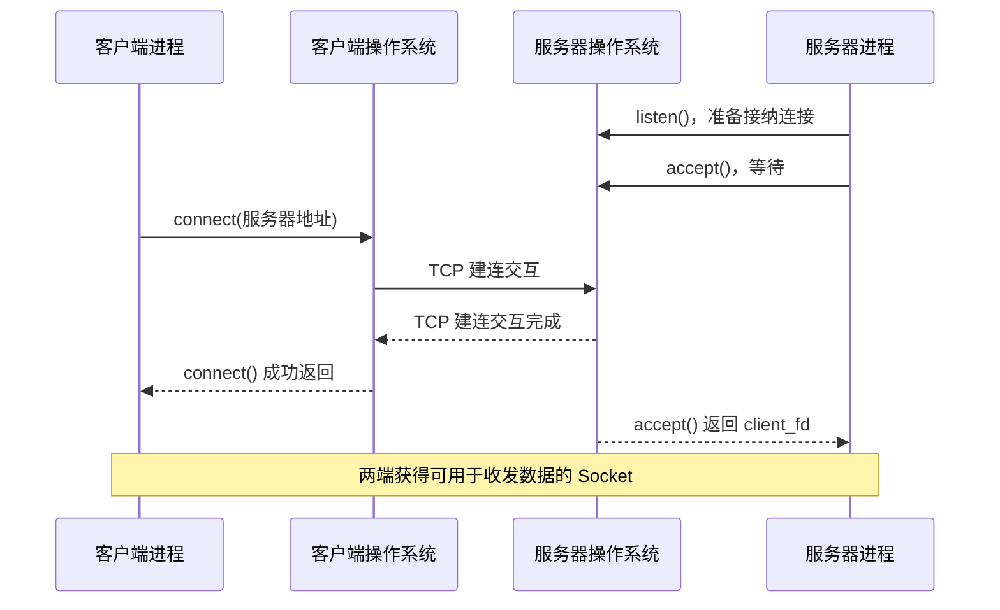
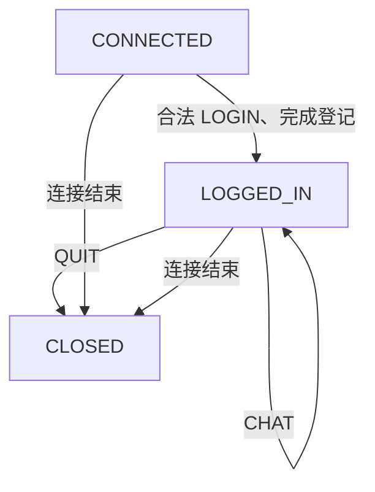
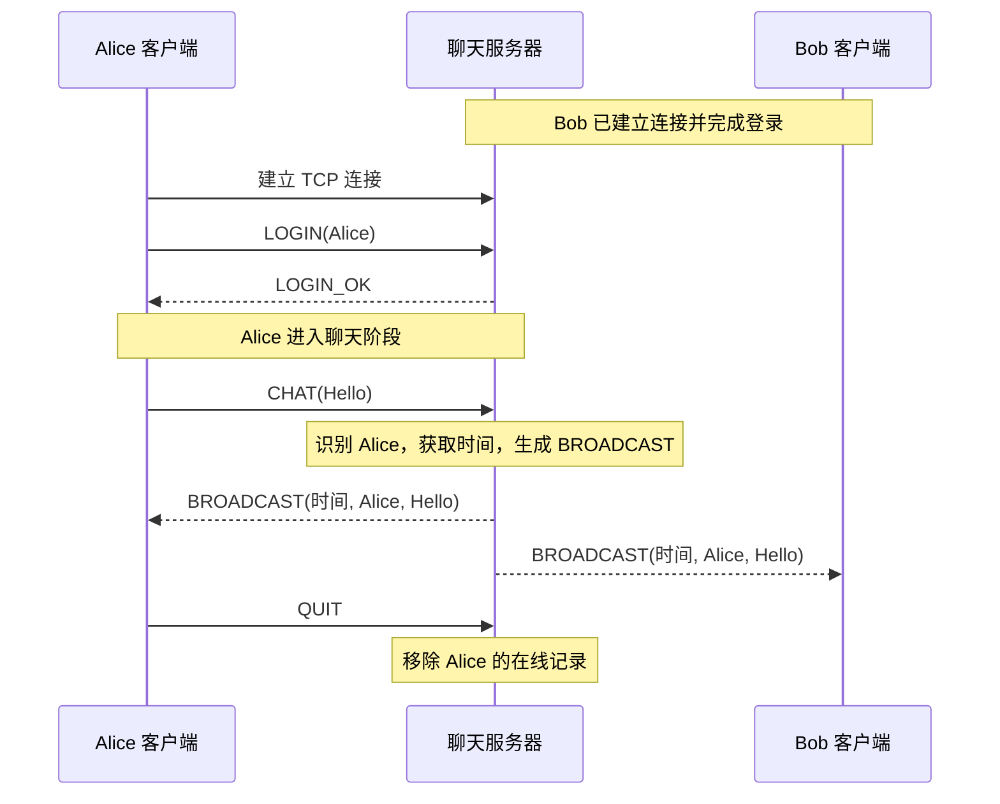
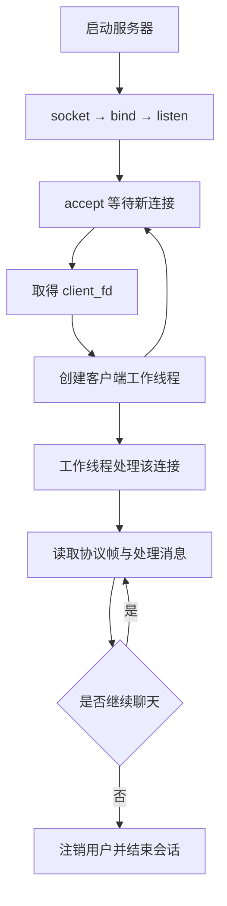
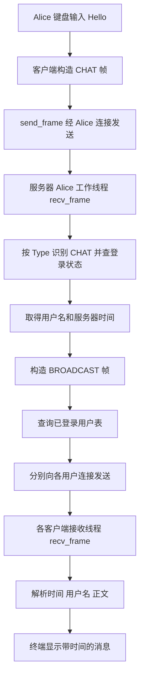

# 理解通信原理与程序运行流程

这份笔记围绕一个具体任务展开：用 C/C++ 的基本 Socket 函数，让多个终端中的聊天程序通过一台服务器交换消息，并在消息旁显示时间。

在阅读代码之前，需要先理解几个连续的问题：两个程序为什么能够交换数据；操作系统怎样为它们建立通信关系；`send()` 写出的数据如何到达 `recv()`；服务器如何识别一条聊天消息；以及多个客户端同时通信时，程序的执行流程如何组织。下面按这些问题产生的先后顺序展开。

## 一、从两个独立的程序开始理解网络通信

### 1. 聊天程序的输入与输出

假设打开两个终端，分别运行 Alice 和 Bob 的聊天客户端。Alice 输入：

```text
Hello
```

期望 Bob 的终端出现：

```text
[2026-10-27 14:30:05] Alice: Hello
```

从 Alice 输入到 Bob 显示，中间至少发生三次转换：

```text
Alice 终端中的文字
    ↓  客户端准备要发送的数据
字节数据
    ↓  通过操作系统和网络传递
服务器收到的字节
    ↓  识别消息、确定发送者、添加时间、转发
Bob 客户端收到的字节
    ↓  识别消息并格式化显示
Bob 终端中的文字
```

这里首先需要关注**两个程序相互独立**这一事实。每次启动一个客户端，操作系统都会为它创建相应的进程。每个进程运行自己的代码、维护自己的变量，正常情况下无法直接读取另一个进程内部的变量。

因此，Alice 在自己的 `std::string` 变量中存入 `Hello`，Bob 的进程不会自动获得这段内容。两个进程需要通过操作系统提供的通信机制交换数据；如果运行在不同计算机上，这套机制还要能够经过网络完成传递。

本实验使用的机制，就是 **TCP + Socket**。

### 2. IP 地址和端口

设想 Bob 的计算机同时运行聊天程序、网页浏览器和其他网络程序。网络传来的数据必须先送到正确的计算机，再交给计算机中正确的通信端点。

这便形成两个层次的定位：

- **IP 地址**用于在 IP 网络中定位通信所使用的主机网络接口。
- **端口号**帮助传输层在主机内区分不同的通信端点和服务。

例如，我们让服务器在本机的 `127.0.0.1:8888` 提供聊天服务。

```text
127.0.0.1 : 8888
    │         │
    │         └── TCP 端口，约定聊天室服务使用 8888
    └──────────── IPv4 回环地址，指向当前系统自身
```

使用 `127.0.0.1`，可以在一台计算机上打开多个终端完成整个实验。之后需要跨计算机运行时，再把服务器地址改为客户端能够访问的服务器 IP。

客户端连接服务器时，也会拥有自己的本地端口，通常由操作系统自动分配。于是可能出现这样的连接：

```text
Alice    127.0.0.1:52001 ───→ 127.0.0.1:8888
Bob      127.0.0.1:52002 ───→ 127.0.0.1:8888
Charlie  127.0.0.1:52003 ───→ 127.0.0.1:8888
```

虽然三个客户端访问的服务器端口相同，操作系统仍能区分这些连接。对于 TCP，一条连接可以用通信双方的 IP 地址与端口组成的四元组描述：

$$
(\text{客户端 IP},\ \text{客户端端口},\ \text{服务器 IP},\ \text{服务器端口})
$$

所以服务器只需在 `8888` 端口建立一个监听入口，就能接受不同客户端建立的多条 TCP 连接。

### 3. 聊天室需要服务器

本实验采用客户端—服务器（Client/Server，简称 C/S）结构。每个客户端只与服务器建立连接，服务器统一记录用户并负责转发消息。

```text
             TCP 连接 A
Alice ───────────────────┐
                         │
              TCP 连接 B │
Bob   ──────────────────┼── 聊天服务器
                        │       │
             TCP 连接 C  │       └── 在线用户表
Charlie ────────────────┘
```

Alice 发送一条聊天消息时，服务器先从**连接 A**读取数据，再通过**连接 B、连接 C**等已建立的连接，把处理后的消息发送给对应客户端。

这里会出现两个重要的数据对象：一是各客户端与服务器建立的 TCP 连接；二是服务器维护的在线用户记录。后续程序必须把它们对应起来，例如记录 `Alice → 连接 A`。这样服务器收到连接 A 中的数据时，才知道这条消息属于 Alice。

### 4. TCP 在整个过程中的位置

C/C++ 程序能够准备聊天内容，但程序本身无需编写网卡驱动、IP 分组转发和 TCP 传输算法。操作系统已有 TCP/IP 协议栈，可以完成这些底层操作。

```text
应用程序
  │  构造聊天消息、调用 send()/recv()
  ▼
Socket 接口
  │  向操作系统提出建立连接、发送、接收等请求
  ▼
操作系统 TCP/IP 协议栈
  │  TCP 维护连接并提供可靠、有序的字节流
  │  IP 负责网络寻址与传送
  ▼
网络
```

TCP 向应用提供的是**面向连接的、有序的字节流**。一旦连接建立，通信两端可以持续写入和读取字节；TCP 按顺序向接收应用交付数据，并通过自身机制处理传输中的部分丢失、乱序等情况。

对于聊天室，初步理解到这里即可：应用程序负责决定传送什么内容、内容如何解释；TCP 负责在连接上运输字节。后面会看到，这两个职责之间还需要设计一层聊天消息协议。

## 二、Socket 让程序建立连接并交换字节

### 1. 从普通变量到 Socket

假设客户端已有一段准备发送的数据：

```cpp
std::string message = "Hello";
```

这段字符串保存在客户端进程的内存里。为了把它送往服务器，程序需要告诉操作系统：要使用什么网络协议、连接哪个目标，以及待发送数据位于哪里。

Socket API 提供了这些操作。在 Linux 中，成功调用 `socket()` 会返回一个**文件描述符**（file descriptor，常简写为 `fd`）。

```cpp
int fd = socket(AF_INET, SOCK_STREAM, 0);
```

可以把文件描述符理解为进程使用操作系统资源时持有的一个编号。程序后续把 `fd` 交给 `connect()`、`send()`、`recv()` 等函数，操作系统就能找到相应的 Socket。

三个参数分别决定这次创建的通信端点使用 IPv4 地址族、流式通信方式以及与前两项匹配的默认协议；在这里就是 TCP。此时操作系统只创建了一个 Socket，程序还没有连接任何服务器。

同样，服务器也要先创建 Socket。但服务器与客户端的下一步操作不同，因为它们在建立连接时承担不同角色。

### 2. 服务器执行顺序

服务器必须先准备一个固定的入口，让客户端知道应该连接到哪里。我们希望客户端都能找到 `127.0.0.1:8888`，所以服务器启动时，需要将这个本地地址交给操作系统，并开始等待连接请求。

完整的启动次序如下：

```text
服务器进程启动
    ↓
socket()  创建一个 Socket
    ↓
bind()    指定本地监听 IP 和端口
    ↓
listen()  使这个 Socket 进入监听状态
    ↓
accept()  等待并接纳一个客户端连接
    ↓
获得新的、专门用于该客户端通信的 Socket
```

先看 `bind()` 所需的地址。Socket 接口使用特定的数据结构向操作系统描述 IP 和端口；IPv4 通常使用 `sockaddr_in`：

```cpp
sockaddr_in server_addr{};
server_addr.sin_family = AF_INET;
server_addr.sin_port = htons(8888);
inet_pton(AF_INET, "127.0.0.1", &server_addr.sin_addr);

bind(listen_fd,
     reinterpret_cast<sockaddr*>(&server_addr),
     sizeof(server_addr));
```

这里的 `htons(8888)` 是把端口整数转换为网络规定的字节排列方式，`inet_pton()` 则将可读的 IP 字符串转换为地址结构可以保存的二进制表示。它们都是为了使操作系统准确获得我们指定的地址。

执行 `bind()` 后，操作系统知道这个 Socket 使用哪个本地地址；执行 `listen()` 后，它开始充当等待客户端连接的入口：

```cpp
listen(listen_fd, 16);
```

第二个参数与等待接纳的连接队列容量有关。对当前实验，重点在于 `listen()` 使服务器进入监听状态。

接下来：

```cpp
int client_fd = accept(listen_fd, nullptr, nullptr);
```

当有客户端的 TCP 连接建立成功后，`accept()` 返回一个新的文件描述符 `client_fd`。至此，服务器同时持有两类 Socket：

```text
listen_fd
    │
    └── 一直保留，用于后续 accept() 新客户端

client_fd
    │
    └── 本次 accept() 返回，用于与一个已连接客户端收发数据
```

如果接下来 Bob、Charlie 也建立连接，服务器会再次调用 `accept()`，取得另外两个已连接 Socket。这样便形成一个监听入口和多条独立连接：

```text
listen_fd  ── 监听 127.0.0.1:8888

alice_fd   ── 服务器 ↔ Alice
bob_fd     ── 服务器 ↔ Bob
charlie_fd ── 服务器 ↔ Charlie
```

**后续聊天数据通过各自的已连接 Socket 发送和接收，监听 Socket 则继续承担接纳新客户端的工作。** 这个区别是理解服务器代码结构的基础。

### 3. 客户端使用 `connect`

客户端已经知道服务器的 IP 和端口，所以创建 Socket 后，可以主动请求连接：

```cpp
int fd = socket(AF_INET, SOCK_STREAM, 0);

sockaddr_in server_addr{};
server_addr.sin_family = AF_INET;
server_addr.sin_port = htons(8888);
inet_pton(AF_INET, "127.0.0.1", &server_addr.sin_addr);

connect(fd,
        reinterpret_cast<sockaddr*>(&server_addr),
        sizeof(server_addr));
```

在这一步，客户端通常可以让操作系统自动决定本地 IP 和临时端口，因此不需要显式执行 `bind()`。客户端也没有接纳其他连接的职责，所以不调用 `listen()` 和 `accept()`。

TCP 建立连接时会进行三次握手，由通信双方的操作系统协议栈完成。可以把它看作 `connect()` 与服务器接纳连接之间的底层过程。



这里先建立的是**TCP 通信关系**，之后客户端还需要通过我们自己设计的聊天协议告诉服务器用户名，服务器才能把连接与聊天室用户对应起来。

### 4. `send()` 和 `recv()` 使用连接

TCP 连接建立后，两端都可以调用 `send()` 和 `recv()`。

```cpp
std::string message = "Hello";
ssize_t n = send(fd, message.data(), message.size(), 0);
```

调用时，`message.data()` 指向待发送字节在本进程内存中的位置，`message.size()` 告诉操作系统准备提交多少字节。操作系统根据 `fd` 确定向哪条连接写入数据。

`send()` 的返回值表示本次实际接收了多少字节用于发送。例如准备发送 100 字节，函数可能只返回 60。此时程序还需处理余下的 40 字节。成功返回也只表明相应数据已交给本机系统处理，远端应用是否已经显示它，需要由应用交互来确定。

另一端可以这样读取：

```cpp
char buffer[1024];
ssize_t n = recv(fd, buffer, sizeof(buffer), 0);
```

这里的 `buffer` 是接收数据写入本进程内存的位置；`sizeof(buffer)` 是本次最多允许读取的字节数。返回 `n > 0` 时，只有缓冲区前 `n` 字节包含本次读到的数据。`recv()` 也可能返回比请求数更少的字节。

| 操作 | 程序交给操作系统的信息 | 取得的结果 |
| --- | --- | --- |
| `socket()` | 通信方式 | Socket 文件描述符 |
| `connect()` | Socket、服务器地址 | 建立连接的结果 |
| `accept()` | 监听 Socket | 某个客户端的已连接 Socket |
| `send()` | 已连接 Socket、待发送字节、长度 | 本次提交的字节数 |
| `recv()` | 已连接 Socket、接收缓冲区、容量 | 本次实际读取的字节数 |
| `close()` | 文件描述符 | 释放该描述符对应的资源引用 |

`recv()` 返回 `0` 表示已读到对端发送方向的正常结束；返回 `-1` 表示系统调用失败。完整的错误分类与恢复策略暂不展开，但正式程序必须根据返回值决定是否继续读写。

### 5. 阻塞为何影响聊天程序的组织方式

目前使用的是默认阻塞式 Socket。假设服务器已经执行：

```cpp
int client_fd = accept(listen_fd, nullptr, nullptr);
```

如果还没有新客户端接入，执行这行代码的线程会暂时停在 `accept()` 中，等到有可接纳的连接才继续向下运行。同样，执行 `recv()` 的线程在没有可读取字节时通常也会等待。

聊天室里的客户端还有一项阻塞操作：等待用户在键盘输入并按回车。例如 `std::getline(std::cin, line)` 可能等待很久。

如果所有工作都写成一条顺序执行路径：

```text
等待输入
  ↓
发送自己输入的消息
  ↓
等待服务器发回一条消息
  ↓
显示
  ↓
回到等待输入
```

那么程序停在键盘输入期间，就没有机会调用 `recv()` 处理别人发来的消息。

服务器也会遇到类似问题：若主线程始终处理 Alice 的 `recv()`，它就无法及时返回 `accept()` 接纳 Bob。

后面使用多线程，就是为了让这些彼此独立、可能发生等待的操作能够并发执行。

## 三、从 TCP 字节流建立应用层聊天协议

### 1. 收到字节后的另一层协议

现在我们已经能够让客户端和服务器交换字节。下一步是让双方知道：**哪些字节组成一条消息，消息的用途是什么，收到后应该做什么。**

首先观察一个简单场景。Alice 连续发送：

```cpp
send(fd, "Hello", 5, 0);
send(fd, "World", 5, 0);
```

TCP 持续运输的是连接上的字节序列。服务器可能分多次读取到：

```text
情况 A：recv() → HelloWorld

情况 B：recv() → Hel
        recv() → loWorld

情况 C：recv() → Hello
        recv() → World
```

三种情况读到的完整字节序列都是 `HelloWorld`。每次 `recv()` 返回多少字节，由当时可读取的数据量、缓冲区容量和系统运行情况共同决定。

聊天室却需要知道，Alice 原本提交的是两条独立内容。TCP 并没有保留 `send()` 调用次数供接收端恢复消息边界，因此需要我们在字节序列里添加标识消息边界的信息。

这便引出了**应用层聊天协议**：由客户端和服务器共同遵守的一组消息组织与处理约定。

### 2. 用长度前缀恢复完整消息

一种容易实现的方案是在每条消息前面放一个固定大小的长度字段。接收方先知道接下来要读取多少字节，再读取完整内容。

我们可以约定：

```text
┌─────────────────────────┬──────────────────────────┐
│ Length                  │ Body                     │
│ 4 字节，记录 Body 长度     │ 恰好 Length 个字节         │
└─────────────────────────┴──────────────────────────┘
```

例如，某条消息体是 `Hello`，一共 5 字节，那么它对应的网络数据可以表示为：

```text
00 00 00 05 | 48 65 6C 6C 6F
    5 字节  |      Hello
```

前四个字节 `00 00 00 05` 是整数 5 的大端序表示，即协议事先规定的字节排列方式。服务器读取前四个字节，就知道后面需要再读取五个字节，才能得到完整消息体。

对于连续到达的数据：

```text
[长度 = 5][Hello][长度 = 5][World]
```

接收端可以恢复两条消息，即使这串数据由一次或多次 `recv()` 返回。

由此，接收算法变成一个持续执行的过程：

```text
读取固定 4 字节长度
    ↓
还原长度 L，检查 L 是否在协议允许范围内
    ↓
继续读取恰好 L 字节
    ↓
得到一条完整消息体
    ↓
按照消息体的格式解析
    ↓
重复处理下一条消息
```

### 3. 循环发送与循环接收

长度字段告诉我们完整消息需要多少字节，但前面已经看到，一次 `send()` 或 `recv()` 可能只完成其中一部分。程序需要在每次调用后记录进度，直到达到预定长度。

例如要发送 10 字节，第一次 `send()` 返回 4；下一次调用应从第 5 个字节开始，继续提交剩余 6 字节。

```text
待发送：ABCDEFGHIJ

第一次 send：ABCD           已发送 4 字节
第二次 send：EFGHIJ         再发送 6 字节

累计发送：10 字节           本次任务完成
```

根据这一过程，可以编写两个基于原生 Socket 函数的辅助算法。下面采用伪代码表达运行逻辑，先不处理完整的系统错误分类。

```text
函数 send_all(fd, bytes, total_length):
    sent = 0

    while sent < total_length:
        n = send(fd, bytes + sent, total_length - sent)
        if n <= 0:
            返回失败
        sent = sent + n

    返回成功
```

`sent` 记录已提交的字节数，`bytes + sent` 指向下一段尚未发送的数据。循环结束时，才能确定指定的整段字节已被本地系统接受。

对应的精确接收算法：

```text
函数 recv_exact(fd, buffer, target_length):
    received = 0

    while received < target_length:
        n = recv(fd,
                 buffer + received,
                 target_length - received)
        if n <= 0:
            返回失败
        received = received + n

    返回成功
```

于是，读取一条长度前缀消息，可以组合成：

```text
函数 read_frame(fd):
    header = recv_exact(fd, 4 字节)
    若没有读完整：返回失败

    L = 将 header 按网络字节序还原为整数
    若 L 超出约定范围：返回失败

    body = recv_exact(fd, L 字节)
    若没有读完整：返回失败

    返回 body
```

这几个辅助算法没有依赖封装后的 Socket 类，底层实际执行的仍是基本 `send()` 和 `recv()`。

### 4. 在消息体里添加“消息类型”

解决了消息边界之后，还会遇到另一件事：服务器收到的内容可能是用户名、聊天正文，也可能是退出指令。如果协议只传送字符串，服务器就无法稳定判断收到的这段字符串应进入哪一种处理逻辑。

因此可以在消息体开头再放一个固定的类型字段：

```text
┌────────────────┬───────────────┬─────────────────────┐
│ Length         │ Type          │ Data                │
│ 4 字节          │ 1 字节         │ 可变长度             │
└────────────────┴───────────────┴─────────────────────┘

Length = 1 + Data 的字节数
```

对于服务器来说，处理顺序是先读取完整帧，再读取 `Type`，最后根据 `Type` 解释 `Data`。这样，消息类型决定了后续操作路径。

我们给这个聊天室约定一套尽可能简单的消息类型：

| 类型编号 | 消息名 | 方向 | Data 的内容 | 接收方执行的操作 |
| --- | --- | --- | --- | --- |
| `0x01` | `LOGIN` | 客户端 → 服务器 | 用户名 | 检查并登记用户 |
| `0x02` | `LOGIN_OK` | 服务器 → 客户端 | 空 | 告知客户端可以进入聊天阶段 |
| `0x03` | `CHAT` | 客户端 → 服务器 | 聊天正文 | 服务器生成广播 |
| `0x04` | `BROADCAST` | 服务器 → 客户端 | 时间、用户名、正文 | 客户端显示消息 |
| `0x05` | `QUIT` | 客户端 → 服务器 | 空 | 结束此次聊天会话 |
| `0x06` | `ERROR` | 服务器 → 客户端 | 简要说明 | 告知请求未被接受 |

例如客户端发送 `CHAT("Hello")`，`Type` 占 1 字节，`Hello` 占 5 字节，因此 `Length = 6`：

```text
00 00 00 06 | 03 | 48 65 6C 6C 6F
    Length  |Type|     Data
             CHAT     Hello
```

服务器解析前四字节得到 `6`，再读取六字节消息体，从首字节 `03` 知道接下来应按照聊天正文处理，剩余的 `Hello` 就是消息内容。

这里约定的具体类型编号属于**本次设计的应用协议**，不是 TCP 自带的类型。

客户端和服务器只要遵守同一套编号与字段格式，就能够互相理解消息。

### 5. 语法、语义和时序处理逻辑

实验要求完整说明聊天协议的语法、语义与时序。这三项实际上回答了三个连续的问题。

**语法**确定一条消息如何表示。例如本协议规定四字节长度、一个字节类型，随后才是不同类型的数据；对于 `BROADCAST`，还需要规定时间、用户名与正文如何排列。

**语义**确定消息被识别之后应产生的操作。例如服务器收到 `CHAT`，就取出正文并进行广播；客户端收到 `BROADCAST`，就将其中的时间、用户名和正文显示到终端。

**时序**确定当前阶段允许哪些消息。新建 TCP 连接的客户端尚未提供用户名，服务器无法把它登记为某个在线用户。因此应先发送 `LOGIN`，等服务器接受后，再发送 `CHAT`。

三者在一次通信里的关系可以写成：

```text
收到字节
   ↓
按照语法解析：这是一条 Type=CHAT 的完整消息
   ↓
检查时序：这个连接已经登录了吗？
   ↓ 是
执行语义：获取正文 → 添加发送者和时间 → 广播
```

为了使示例协议可以执行，还要固定少量必要约束：例如 `Length` 的合法上限可以设为 4096 字节，用户名长度要有上限且不能包含换行，用户名在同一聊天室中应唯一。客户端与服务器应使用一致的文本字节表示规则，具体编码细节留到扩展笔记。

### 6. 服务器需要维护登录状态

服务器执行 `accept()` 后，确实已经拥有与客户端通信的 TCP Socket，但此时只有一条网络连接，还不知道对应的聊天室用户名。

我们可以为每条连接维护一个简单状态：

```text
CONNECTED：TCP 已连接，等待 LOGIN

LOGGED_IN：LOGIN 已通过，允许发送 CHAT

CLOSED：退出并完成资源清理
```

状态转换：



这里 `CHAT` 指向 `LOGGED_IN` 自身，表示收到聊天消息后，用户仍然保持在线；变化的是服务器生成并发出了一条广播消息。`LOGIN` 则会改变连接对应的应用状态，并把用户名与连接关联起来。

服务器判断发送者身份时，应查询该连接对应的已登记用户名。例如从 `alice_fd` 收到 `CHAT`，就使用在线表中记录的 Alice。这样所有接收者都能看到同一个由服务器确定的发送者名称。

### 7. 带时间的广播消息如何产生

实验要求聊天信息包含时间。这里选择由**服务器在处理 `CHAT` 时获取时间**。这样一条广播消息的时间由服务器统一确定，多个接收者看到相同的时间值。

发送端提交的是：

```text
CHAT("Hello")
```

服务器获取当前时间后，构造：

```text
BROADCAST(时间, 用户名, "Hello")
```

为便于实现，可以约定 `BROADCAST` 的 `Data` 按如下格式排列：

```text
YYYY-MM-DD HH:MM:SS\n用户名\n正文
```

约定时间使用服务器本地时间，并在协议说明中写明时区。用户名不包含换行，客户端在收到 `BROADCAST` 后，以前两个换行符为界取得时间与用户名，其余部分作为正文。

对于客户端来说，最终显示为：

```text
[2026-10-27 14:30:05] Alice: Hello
```

此时间表示服务器处理这条 `CHAT` 时记录的时刻。它会成为广播帧的一部分，随同用户名和正文一起传送给各个接收者。

完整交互时序：




## 四、从单连接过渡到多人聊天：线程与共享状态

### 1. 服务器为不同连接安排独立的执行路径

假设服务器只有一个线程，并写成如下结构：

```text
accept() 接纳 Alice
    ↓
一直 recv(alice_fd)，处理 Alice 的消息
    ↓
Alice 退出
    ↓
再次 accept() 接纳 Bob
```

在 Alice 保持连接期间，服务器很可能始终等待 `alice_fd` 的新数据。此时 Bob 的连接无法及时被应用接纳和处理，更无法实现三个人同时聊天。

我们的目标是让服务器一边等待新客户端，一边处理已有客户端。这可以通过多线程完成。

线程是进程内部可以被操作系统并发调度的执行单元。同一个服务器进程可以拥有多个线程，它们共享服务器进程中的在线用户表等资源，却分别执行不同代码路径。

对小规模课程聊天室，最直观的结构是：

```text
服务器进程
│
├── 主线程
│      └── 循环 accept()，每次接纳新连接后创建工作线程
│
├── Alice 工作线程
│      └── 接收和处理 alice_fd 上的消息
│
├── Bob 工作线程
│      └── 接收和处理 bob_fd 上的消息
│
└── Charlie 工作线程
       └── 接收和处理 charlie_fd 上的消息

共享的数据：在线用户表
```

Alice 的工作线程即使正在 `recv(alice_fd)` 中等待，主线程仍然可以接纳其他连接，Bob 的工作线程也可以处理 Bob 发来的聊天消息。

### 2. 服务器用户个数记录

为了完成广播，服务器需要随时知道有哪些已登录用户，以及他们各自使用哪个连接。可以建立一个在线表：

| 用户名 | 对应连接 | 状态 |
| --- | --- | --- |
| Alice | `alice_fd` | 已登录 |
| Bob | `bob_fd` | 已登录 |
| Charlie | `charlie_fd` | 已登录 |

这里的表格只是理解数据结构的方式。C++ 程序中可使用 `std::vector`、`std::map` 等容器保存用户记录，记录内包含用户名、Socket 描述符，以及后面要介绍的发送同步信息。

当收到 Alice 发来的 `CHAT("Hello")`，服务器执行：

```text
Alice 工作线程：从 alice_fd 读取完整 CHAT
    ↓
找到 alice_fd 对应的用户名 Alice
    ↓
取得服务器时间，生成 BROADCAST
    ↓
从在线表取得广播接收者
    ↓
逐一向 alice_fd、bob_fd、charlie_fd 发送该广播帧
```

如果约定广播也发回原发送者，那么 Alice 自己的终端也会显示服务器确认处理后的消息。这是一项应用层规则，必须在协议说明中固定。

### 3. 访问在线表需要互斥锁

服务器中的几个工作线程可能同时使用在线表。例如：

```text
Alice 工作线程：正在遍历在线表，准备广播
Bob 工作线程：  正在处理 Bob 退出，准备删除 Bob
```

这两个操作都会接触同一份容器。一边遍历一边由另一线程修改容器，可能使遍历过程中使用的元素位置或引用失效，还可能造成 C++ 数据竞争。

因此，<mark style="background:#fdbfff"><font color="#7030a0">需要通过互斥锁协调对共享数据的访问。</font></mark>

可以理解为：某个线程先取得在线表的访问权，在这一段受保护的操作完成后释放；其他需要修改或读取同一份共享状态的线程遵循相同规则。

```cpp
std::mutex clients_mutex;

{
    std::lock_guard<std::mutex> guard(clients_mutex);
    // 在这里查询或修改共享在线表
}
// 离开作用域后自动释放锁
```

互斥锁保护的是**多个线程共享的可变状态**。例如每个工作线程内部单独创建的接收缓冲区，通常不需要使用这个在线表锁。

广播时还应考虑 `send()` 可能等待的情况。一般会在短暂持有在线表锁时取得有效接收者，再释放在线表锁执行网络发送；同时需要保证这些接收者对应的连接在发送结束前仍然有效。这涉及连接资源的使用权与关闭时机，正式设计中应统一管理。

### 4.向同一连接发送完整消息的协调

假设 Alice 和 Bob 几乎同时发消息，服务器的两个工作线程都要向 Charlie 广播。我们设计的一条完整消息帧包含长度字段和消息体，发送时可能经过多次 `send()`。

若两个线程对 `charlie_fd` 的写入没有约束，可能出现以下执行交错：

```text
线程 A：向 charlie_fd 写入消息 A 的长度
线程 B：向 charlie_fd 写入消息 B 的长度与正文
线程 A：向 charlie_fd 写入消息 A 的正文
```

Charlie 看到的连续字节就可能变成：

```text
[长度 A][长度 B][正文 B][正文 A]
```

按照长度前缀解析时，会把一些其他消息的字节误当作正文，导致消息格式被破坏。

因此，每个客户端连接可以拥有自己的**发送互斥锁**。向同一个连接发送时，必须把整条帧（长度字段和消息体）的发送过程作为一个受保护的操作：

```text
取得 Charlie 连接的发送锁
    ↓
发送一条完整 BROADCAST 帧
    ↓
释放 Charlie 连接的发送锁
```

在线表锁保护共享的用户集合；每连接发送锁保护该连接上的帧写入顺序。二者服务于不同对象，不能互相替代。

同样，每条 TCP 连接应当由一个明确的接收线程连续读取和解析。多个线程抢着对同一个连接调用 `recv()`，可能使长度字段和正文分别落入不同线程，导致无法正确还原一帧。

### 5. 客户端需要多线程

客户端同时承担两项持续进行的任务：等待用户在键盘输入并发送消息，以及接收服务器随时可能发来的广播。任何一项都可能长时间等待。

可以让客户端主线程负责输入与发送，另建一个接收线程负责读取与显示：

```text
一个客户端进程
│
├── 主线程：输入与发送
│     ├── 等待键盘输入
│     ├── 构造 CHAT
│     └── send_frame()
│
└── 接收线程：接收与显示
      ├── recv_frame()
      ├── 解析 BROADCAST
      └── 输出到终端
```

进入聊天阶段之前，可以先由主线程发送 `LOGIN` 并读取 `LOGIN_OK`，确认完成登录后，再启动持续接收线程。这样连接在任意时刻都有明确的接收者，便于控制消息解析顺序。

## 五、把前面的机制组合成一套可执行程序

### 1. 从任务分工理解模块划分

我们已经看到聊天室同时涉及连接建立、完整收发、协议解释、在线状态和并发执行。把职责分开，能够让各部分的代码与它们处理的数据一一对应。

一个适合课程实验的最小模块划分如下：

| 模块 | 接受的输入或已有状态 | 主要处理 | 产出的结果 |
| --- | --- | --- | --- |
| Socket 建连模块 | IP、端口 | `socket/bind/listen/accept/connect` | 监听 Socket 或已连接 Socket |
| 帧收发模块 | Socket、字节数据 | `send_all/recv_exact`、长度帧读写 | 完整发送或读取一条帧 |
| 协议处理模块 | 完整消息帧、连接当前状态 | 解析 `Type`、解释 `Data`、构造响应 | `LOGIN_OK`、`BROADCAST` 等消息 |
| 在线用户管理模块 | 用户名、连接及其状态 | 登记、查找、注销，协调共享访问 | 当前有效的用户集合 |
| 服务器并发模块 | 新接入连接 | 为各连接安排工作线程 | 多个客户端并发被处理 |
| 客户端交互模块 | 键盘输入、服务器广播 | 发送聊天消息、接收并显示 | 用户可操作的聊天界面 |
这些是**逻辑模块**，不要求每一项都写成独立类。可以使用普通 C++ 函数、结构体与少量源文件组织，保留原生 Socket API 作为网络通信基础。

### 2. 最底层：完整发送一帧与完整读取一帧

已有 `send_all()` 与 `recv_exact()` 后，可以在其上实现协议帧收发。

```text
函数 send_frame(fd, type, data):
    body = [1 字节 type] + data
    L = body 的字节数
    检查 L 是否有效
    header = 将 L 转换为 4 字节网络字节序

    send_all(fd, header, 4)
    send_all(fd, body, L)
```

若连接可能同时被多个线程写入，调用方应在整个 `send_frame()` 期间持有该连接的发送锁。

```text
函数 recv_frame(fd):
    header = recv_exact(fd, 4 字节)
    L = 解码 header
    检查 L 是否有效
    body = recv_exact(fd, L 字节)

    type = body 的第 1 字节
    data = body 剩余字节
    返回 (type, data)
```

`send_frame()` 将一个应用消息变成能在 TCP 字节流上传输的数据；`recv_frame()` 将读取到的字节还原为一个完整应用消息。上层协议处理只需接收 `(type, data)`，就能开始判断消息含义。

### 3. 服务器主线程：持续接纳连接

服务器刚启动时，已知监听地址和端口，在线表为空；还不存在任何客户端工作线程。

```text
输入：server_ip, server_port

创建在线用户表 clients = {}
创建在线表互斥锁 clients_mutex

listen_fd = socket(AF_INET, SOCK_STREAM, 0)
bind(listen_fd, server_ip, server_port)
listen(listen_fd, backlog)

while 服务器正在运行:
    client_fd = accept(listen_fd)
    如果接纳成功:
        创建连接会话状态 session(client_fd)
        创建工作线程 handle_client(session)
        主线程继续等待下一个客户端

结束服务时协调工作线程结束，再释放相关 Socket
```

注意主线程在创建工作线程后继续回到 `accept()`。对某个客户端的具体聊天处理交由工作线程完成。



### 4. 服务器工作线程：从登录到广播

服务器为每条连接分配一个会话状态，至少包含已连接 Socket、当前用户名和登录状态。工作线程首先处理登录，登录通过后进入聊天循环。

```text
函数 handle_client(session):
    fd = session.fd
    state = CONNECTED

    while 会话仍在进行:
        (type, data) = recv_frame(fd)
        如果连接结束或无法得到完整帧:
            break

        if state == CONNECTED:
            if type == LOGIN:
                检查用户名并协调在线表登记
                如果通过:
                    发送 LOGIN_OK
                    标记并激活已登录会话
                    state = LOGGED_IN
                否则:
                    按约定拒绝本次登录
            else:
                按协议拒绝此阶段的消息

        else if state == LOGGED_IN:
            if type == CHAT:
                username = session 中已登记的用户名
                timestamp = 当前服务器时间
                message = 构造 BROADCAST(timestamp, username, data)
                receivers = 获取有效在线接收者
                for each receiver in receivers:
                    在 receiver 的发送锁保护下发送完整 message

            else if type == QUIT:
                break

            else:
                按协议处理其他消息

    将会话从在线表中移除
    协调会话不再被其他广播线程使用
    关闭该连接，结束工作线程
```

为了保证登录确认与后续广播的顺序，实现时需要协调新用户进入广播接收者集合的时机；可以在发送 `LOGIN_OK` 后将其激活为广播接收者，并对用户名占用进行同步管理。

这里要掌握的主线是：**每条连接有自己的登录状态，登录成功后才参与聊天；收到 `CHAT` 会触发服务器对多个已登录连接发送 `BROADCAST`。**

### 5. 客户端：连接、登录、收发与退出

```text
输入：server_ip, server_port, username

fd = socket(AF_INET, SOCK_STREAM, 0)
connect(fd, server_ip, server_port)

send_frame(fd, LOGIN, username)
response = recv_frame(fd)
如果 response 不是 LOGIN_OK:
    结束本次会话

启动接收线程：
    while 会话仍在进行:
        (type, data) = recv_frame(fd)
        if type == BROADCAST:
            解析 timestamp、username、content
            格式化输出到终端
        else if 连接结束:
            退出接收循环

主线程负责输入：
    while 会话仍在进行:
        line = 等待键盘输入
        if line == "/quit":
            send_frame(fd, QUIT, 空)
            break
        else:
            send_frame(fd, CHAT, line)

协调接收线程结束
等待线程退出并关闭 fd
```

这里通过 `/quit` 约定一个终端操作命令。它是客户端识别的退出输入，随后客户端将其转换为协议中的 `QUIT` 消息。客户端收到 `BROADCAST` 后再打印时间、用户名与正文，从而保持输入端、服务器与显示端各自的职责清晰。

### 6. 完整全流程梳理

现在把前面所有概念放入同一条真实执行链。假设服务器已经启动，Bob、Charlie 均已登录。

**阶段一：Alice 建立连接。** Alice 客户端创建 Socket，使用 `connect()` 访问服务器 `127.0.0.1:8888`；服务器主线程从 `accept()` 得到 `alice_fd` 并创建 Alice 工作线程。此时 Alice 还未成为已登录用户。

**阶段二：Alice 登录。** 客户端把 `LOGIN(Alice)` 封装成长度帧，通过 `send_frame()` 写入连接。Alice 工作线程从 `alice_fd` 调用 `recv_frame()`，解析出 `LOGIN` 类型与用户名。服务器验证并建立连接与 Alice 的关联，回送 `LOGIN_OK`，Alice 客户端进入聊天阶段。

**阶段三：Alice 输入消息。** Alice 的输入线程读到 `Hello`，构造 `(Type=CHAT, Data=Hello)`，写入包含长度字段的完整消息帧。服务器上的 Alice 工作线程读取、还原该帧，检查会话已登录，然后取出其对应用户名。

**阶段四：服务器处理与广播。** 服务器获取当前时间，构造 `BROADCAST(时间, Alice, Hello)`，从在线表确定 Alice、Bob、Charlie 是有效接收者，分别通过三个已连接 Socket 发送完整广播帧。向某个连接发送期间，由对应发送锁保持这一帧的字节顺序。

**阶段五：各客户端显示。** Bob 和 Charlie 的接收线程分别从自己的 Socket 读到完整 `BROADCAST`，按协议提取时间、用户名与正文，在终端显示同一条聊天消息。Alice 也可以收到自己的广播，具体取决于前面确定的广播规则。

这一过程可以压缩为一张从应用输入到输出的运行图：



