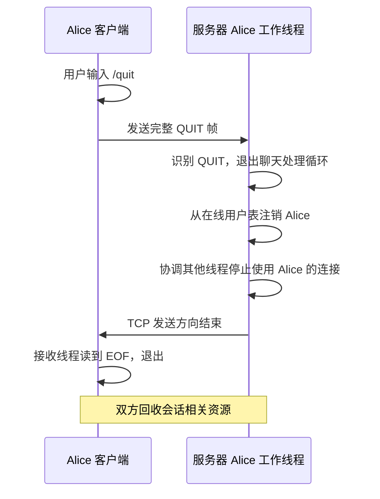
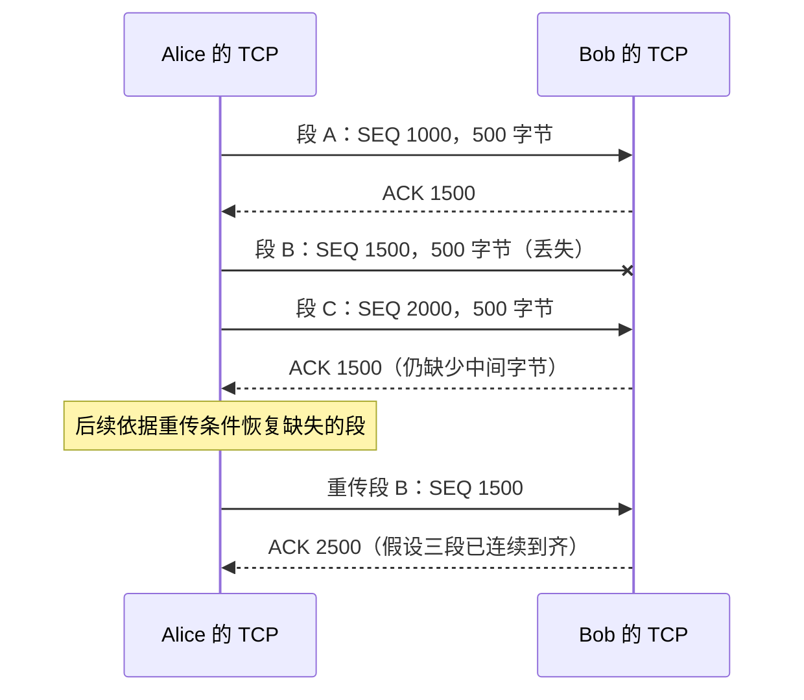
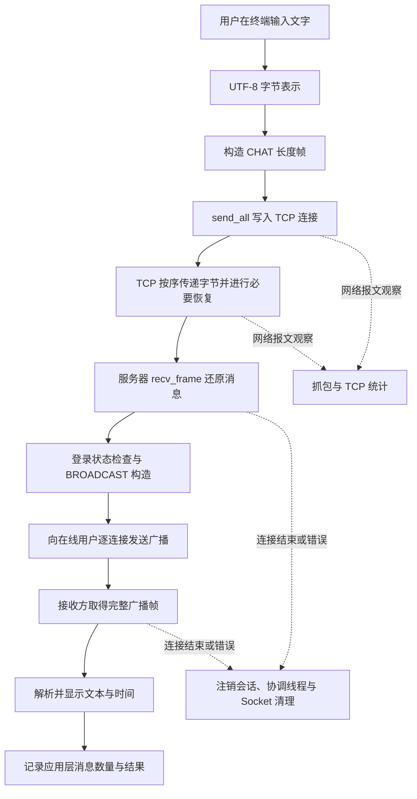

# TCP Socket 多人聊天室实验：补充知识与实验观察

前置笔记已经建立了一条能够运行的聊天室主线：客户端连接服务器，将输入组织成聊天消息；服务器接收完整消息，查找发送者、添加时间，再通过各个客户端的 TCP 连接广播。多个工作线程使这些连接可以同时得到处理。

现在沿着这条已经理解的流程，研究实际运行时会遇到的几个进一步问题：键盘输入的文字怎样成为 Socket 可以传输的字节；用户离开后连接和线程怎样结束；TCP 为什么能够在传输过程中恢复部分丢失的数据；我们又怎样通过程序输出和网络抓包观察这一切。

## 一、从终端文字到网络字节：理解中英文聊天

### 1. 从用户输入一个字符开始

考虑 Alice 在终端输入 `A`，随后输入 `你`。对用户来说，它们都是一个能够显示的字符。对于 Socket 来说，发送函数接收的是一段内存地址以及要发送的**字节数**：

```cpp
send(fd, data, length, 0);
```

所以需要先解决：终端显示的字符在内存里保存成什么数据？`length` 又应当怎样确定？

计算机内存的基本存储单位是字节（byte），一个字节由 8 位（bit）组成。例如十六进制 `41` 可以写成二进制 `01000001`。字节本身只包含数值，文字的含义来自事先共同采用的**字符编码规则**。

对于英文字母 `A`，ASCII 编码规定它对应数值 65，即十六进制 `0x41`。于是一个程序可以保存字节 `41`，接收程序再依照编码规则将它显示为 `A`。

汉字的种类远多于 ASCII 能够表示的字符。为了让不同语言的文字能够使用统一的编号体系，Unicode 为大量字符规定了相应的码点（code point）。例如汉字 `你` 的 Unicode 码点为 `U+4F60`。

**码点还需要经过编码，才能变成保存在内存里、适合传送的具体字节。** UTF-8 就是一种广泛使用的 Unicode 编码方式。采用 UTF-8 时：

```text
用户看见的文字： A       你           好
Unicode 码点：  U+0041  U+4F60       U+597D
UTF-8 字节：    41      E4 BD A0     E5 A5 BD
占用字节数：     1         3            3
```

于是 `A你好` 在屏幕上包含三个字符，在 UTF-8 表示中则需要七个字节：

$$
L_{\text{UTF-8}}(\texttt{A你好}) = 1 + 3 + 3 = 7\ \text{bytes}
$$

这里的长度是网络传输需要的长度。后面无论构造 `CHAT`，还是计算帧头中的 `Length`，都应当使用这段 UTF-8 数据实际占用的**字节数**。

### 2. 字符怎样进入 C++ 的 `std::string`

假设 Linux 终端采用 UTF-8，Alice 输入：

```text
你好
```

程序调用：

```cpp
std::string line;
std::getline(std::cin, line);
```

终端输入经由程序的标准输入到达 `std::getline()`，这一函数将读到的一行内容保存到 `line`。`std::string` 存储的是连续的字符类型数据；在当前 UTF-8 环境中，这些数据构成一段 UTF-8 字节序列。

```cpp
std::string line = "你好";
std::cout << line.size() << '\n';
```

如果源文件与执行环境采用 UTF-8，这里输出 `6`。两个汉字分别占三个字节，`size()` 返回存储的字节数。`std::getline()` 读到行分隔符后结束读取，通常不会把末尾的换行符保存在 `line` 中。

对于我们的聊天协议，这种表示十分方便。因为协议按字节规定消息体长度，而 `line.data()` 和 `line.size()` 恰好可以分别提供字节数据的地址和字节数。

需要额外区分：`std::string::size()` 用于计算字节长度；如果以后要实现“用户名最多允许 10 个可见字符”，就要另外考虑 Unicode 字符的计数规则。当前实验可以直接约定用户名最多允许多少个 UTF-8 **字节**，避免引入与聊天主线无关的复杂文本处理。

### 3. UTF-8 进入我们设计的消息帧

现在 Alice 想发送 `CHAT("你好")`。按照主线笔记的协议，`Type = 0x03`，`Data` 是正文的 UTF-8 字节。

```text
正文：       你       好
UTF-8：     E4 BD A0 E5 A5 BD              → 6 字节
Type：      03                              → 1 字节
Length：    00 00 00 07                     → 消息体共 7 字节

发送的完整帧：
00 00 00 07 | 03 | E4 BD A0 E5 A5 BD
     │        │           │
   Length    CHAT       Data（UTF-8）
```

发送方先计算 `Data` 的字节长度，拼接 `Type` 和 `Data` 得到 `Body`，然后将 `Body` 的长度写入前四字节，最后调用 `send_all()` 发送完整帧。

接收方依照长度字段取得完整的七字节 `Body`，读取首字节 `03`，再将剩下六个字节作为文本数据。这便把主线中的帧收发算法与具体的文字编码连接起来：

```text
Alice 输入“你好”
    ↓  终端环境使用 UTF-8
std::string 保存 6 字节正文
    ↓  添加 Type 与 Length
[00 00 00 07][03][E4 BD A0 E5 A5 BD]
    ↓  TCP 发送字节
服务器读取完整帧，提取 6 字节 Data
    ↓  根据连接状态认出发送者 Alice
服务器构造带时间的 BROADCAST
    ↓  发往各在线客户端
Bob 的接收线程取得完整广播
    ↓  提取正文的 UTF-8 字节
终端显示“你好”
```

UTF-8 编码的内容也可以和 `BROADCAST` 中的时间、用户名一起传送。根据主线约定，`BROADCAST` 的 `Data` 使用：

```text
YYYY-MM-DD HH:MM:SS\n用户名\n正文
```

接收方找到**前两个换行符**，提取时间与用户名，再把余下字节看作正文。由于时间和用户名本身采用固定约束，不含换行，这种分隔方式能够和长度前缀共同确定各个字段的位置。正文使用 UTF-8，字段间的 `\n` 是单字节分隔符。

### 4. `recv()` 恰好在一个汉字中间返回时会发生什么

前置笔记说明，TCP 提供连续字节流，一次 `recv()` 可能只读到帧的一部分。这也可能发生在一个 UTF-8 字符的中间。例如，发送 `你好` 时，接收端分两次得到：

```text
第一次 recv：E4 BD
第二次 recv：A0 E5 A5 BD
```

第一次仅有 `你` 的前两个字节，尚无法恢复这个完整字符。假设程序每调用一次 `recv()` 就立刻把所得字节作为文字打印，显示结果就可能出现乱码或替代字符。

我们的长度帧接收方式已经提供了解决这个问题的基础：先通过 `recv_exact()` 收齐完整消息体，再把其中的 `Data` 交给显示或文本解析逻辑。

```text
接收字节片段 → 按 Length 累积 → 取得完整 Body
                                      ↓
                              识别 Type、取得 Data
                                      ↓
                              按 UTF-8 解释文本
```

这样，Socket 每次返回的位置不会影响最终还原出的文本。它同时再次说明：**解决 TCP 消息边界的问题，也为后续正确处理文本提供了必要条件。**

### 5. 为中文显示准备一致的运行环境

沿着上述过程，双方需要共同遵守 UTF-8 编码约定。实际运行时，应确认源文件、终端输入输出环境和应用协议的文本表示保持一致。

在 Linux / WSL 终端中可以检查：

```bash
locale
```

输出中的 `LANG` 或相关 `LC_*` 项如果采用 `UTF-8` 环境，一般能够支持常见中英文输入和显示。程序运行的终端还需要具备相应字体；字符编码正确而字体缺字时，屏幕也可能无法正确显示。

可以从最小测试逐步扩展：先发送 `A`，再发送 `你好`，随后发送 `A你好`，最后通过完整的 `CHAT → BROADCAST` 流程确认多人客户端都显示出相同文本。每一次扩展都建立在前一步已经能正确传输和显示的基础上。

## 二、从一条连接的结束开始：Socket 关闭与程序退出

### 1. TCP 连接一直存在会怎样

聊天室启动后，Alice 与服务器之间的 TCP 连接保持建立状态。她发送一次消息，连接仍然可以继续用于下一次发送；服务器也可能随时向 Alice 广播别人的消息。

这条连接实际上支持两个独立的数据流向：

```text
Alice 客户端                       服务器

          ──── 发送字节 ────→
          ←─── 接收字节 ─────
```

当 Alice 决定退出时，双方需要逐步结束正在进行的读写，并释放相关资源。因此需要先区分三个对象：

- `QUIT` 是我们定义的**聊天室消息**。它使服务器知道 Alice 希望结束此次聊天会话。
- TCP 连接由操作系统维护，通信方向可以通过 TCP 关闭过程逐步结束。
- Socket 文件描述符是当前进程持有的资源引用，最终要由进程通过 `close()` 释放。

这三者处于不同的工作层次。它们会在一次正常退出过程中先后出现。

### 2. `recv()` 如何知道对方停止发送

设服务器工作线程正在执行：

```cpp
char buffer[1024];
ssize_t n = recv(alice_fd, buffer, sizeof(buffer), 0);
```

如果 Alice 暂时没有发送新内容，阻塞式 `recv()` 就继续等待。Alice 对 TCP 的发送方向执行有序关闭后，服务器会先取得关闭前已经到达的剩余字节；当这些数据都读取完毕，下一次 `recv()` 返回 `0`，表示读取到了这个方向的字节流末尾（EOF）。

因此接收循环至少要区分三类返回值：

| 返回值 | 当前线程观察到的情况 | 后续动作 |
| --- | --- | --- |
| `n > 0` | 已取得 `n` 字节 | 继续按帧协议累积或解析 |
| `n == 0` | 对方发送方向已经正常结束，数据已读完 | 结束接收循环，进入会话收尾 |
| `n == -1` | 本次系统调用失败 | 读取 `errno`，决定重试或结束 |

其中 `recv()` 返回 `0` 是非常重要的正常结束信号。对于阻塞式 Socket，只有把这个返回值纳入循环条件，接收线程才能在对方关闭发送方向后退出。

### 3. 一次正常退出按怎样的顺序执行

沿用客户端识别 `/quit`、然后向服务器发送 `QUIT` 的规则。一种直观的会话结束流程是：



这里一个容易遗漏的环节是：**服务器移除在线记录时，还可能有别的工作线程准备向 Alice 的连接广播**。需要先协调这些正在进行或即将开始的发送操作，再让连接资源最终失效。否则其他线程可能继续使用已经关闭的描述符。

退出不仅意味着某个函数 `break` 了，还意味着与该会话有关的在线记录、连接资源和工作线程都要结束使用。

### 4. `shutdown()`、`close()` 与 TCP 的关闭过程

在 Linux 下，两个常见接口是：

```cpp
shutdown(fd, SHUT_RDWR);
close(fd);
```

`shutdown()` 可以改变 Socket 对应 TCP 连接的读写方向状态。`SHUT_WR` 表示本端结束发送方向；`SHUT_RD` 表示本端停止接收方向；`SHUT_RDWR` 同时作用于两个方向。

`close(fd)` 释放当前进程持有的文件描述符。对于没有其他引用的已连接 TCP Socket，关闭会促使相关连接资源进入释放过程，具体 TCP 结束行为由套接字状态和操作系统处理。

这里可以从一个简化的顺序理解：

```text
准备退出
    ↓
结束业务交互（例如发送 QUIT）
    ↓
协调相关线程停止进一步读写
    ↓
按需要使用 shutdown() 促使阻塞接收结束
    ↓
确认不再有线程使用 fd
    ↓
close(fd)，释放描述符
```

TCP 正常结束连接时会使用 `FIN` 等控制信息。由于双方的发送方向可以分别结束，教材中常把正常关闭过程绘成“四次挥手”。它表达的核心是：一端结束发送以后，另一端可能还有数据要发送，所以两个方向可以独立完成关闭。实际抓包中控制报文可能合并，观察到的报文数量并不总是固定为四个。

在课程程序中，理解 `QUIT`、`shutdown()`、`close()` 与 `recv() == 0` 的因果关系，比记住每一种 TCP 关闭状态名称更直接有用。

### 5. 为什么客户端退出时还要考虑线程

前置笔记中，一个客户端通常有两个执行路径：主线程等待键盘输入并发送，接收线程阻塞在 `recv_frame()` 等待广播。

如果主线程读到 `/quit` 后直接退出，接收线程可能依然在等待服务器字节。程序需要让接收线程结束，并由适当的管理者回收它。

C++ `std::thread` 的 `join()` 会等待指定线程结束；调用 `join()` 前，必须先保证接收线程存在结束路径。对于 Socket 接收线程，一种常见方法是在业务退出后使用 `shutdown()` 促使正在等待的网络读取完成或失败，然后让它离开循环。

可以将客户端收尾设计成：

```text
输入线程：
    读取 /quit
    如果会话可发送：send_frame(QUIT)
    请求本地会话结束
    协调 Socket 结束接收
    等待接收线程退出（join）
    在无其他线程使用 fd 时 close(fd)

接收线程：
    循环 recv_frame()
    收到 BROADCAST → 显示
    收到 EOF 或需要结束的错误 → 退出循环
```

还有一个反向场景：服务器主动关闭连接，客户端接收线程率先获知 EOF，而主线程正等待用户在终端输入。`shutdown()` 对网络读取有作用，却不会自动中断另一个线程的 `std::getline(std::cin, ...)`。因此正式设计需要说明这种情况下如何通知用户、如何让输入线程结束，或者在程序要求允许的范围内等待用户下一次输入后退出。

这反映了多线程程序的一个普遍原则：**线程退出条件取决于它当前等待的资源**。网络接收线程与终端输入线程，分别等待不同的输入源。

## 三、程序运行中的错误：从返回值到状态恢复

### 1. 为什么每次系统调用都要检查返回值

我们已经知道 `connect()`、`accept()`、`send()`、`recv()` 都是应用向操作系统发出的请求。程序可以发出请求，但执行结果由当时的系统状态决定。

例如客户端尝试连接 `127.0.0.1:8888`，而服务器程序尚未启动。此时目标端口没有正常接纳连接的监听服务，连接就可能被拒绝。客户端需要根据 `connect()` 的返回值及时终止下一步操作，否则继续调用 `send()` 就没有正确的连接基础。

Linux 系统调用通常通过返回值表明成功或失败。很多 Socket 接口失败时返回 `-1`，并将更具体的错误原因放入 `errno`。

```cpp
if (connect(fd,
            reinterpret_cast<sockaddr*>(&server_addr),
            sizeof(server_addr)) == -1) {
    perror("connect");
    close(fd);
    return 1;
}
```

`perror("connect")` 能够结合当前 `errno` 输出错误信息。实际编写程序时，应在失败分支及时检查或保存 `errno`，避免后续系统调用改变它。

### 2. 相同的 `-1` 为什么可能需要不同处理

考虑接收线程在阻塞的 `recv()` 中等待。这个系统调用可能被信号中断，返回 `-1`，并把 `errno` 设为 `EINTR`。如果应用仍希望继续接收，可以重新调用 `recv()`。

另一种情况是对端连接已复位，例如某些场景下 `errno` 为 `ECONNRESET`。此时当前连接的通信条件已发生实质变化，继续使用原来的会话通常无法完成正常聊天，应结束本连接的处理。

因此，系统调用失败后应根据错误性质决定状态变化：

```text
执行 recv()
    ↓
检查返回值
    ├── n > 0  → 本轮取得字节，更新接收进度
    ├── n == 0 → 字节流结束，进行连接清理
    └── n < 0 → 检查 errno
                    ├── EINTR → 继续尝试接收
                    └── 其他需要结束的错误 → 清理会话
```

下面是一个简化的接收循环片段：

```cpp
while (true) {
    ssize_t n = recv(fd, buffer, sizeof(buffer), 0);

    if (n > 0) {
        // 将实际读到的前 n 字节交给帧解析过程
        continue;
    }
    if (n == 0) {
        // 对方发送方向正常结束
        break;
    }
    if (errno == EINTR) {
        // 可重试的系统调用中断
        continue;
    }

    perror("recv");
    break;
}
```

这个例子展示的是错误分支的处理结构。它省略了真正的长度帧缓冲区管理，不能直接取代主线笔记中的 `recv_frame()`。

### 3. 常见错误如何映射到通信流程

| 观察到的现象 | 出问题的阶段 | 可以先检查什么 |
| --- | --- | --- |
| `bind(): Address already in use` | 服务器占用监听地址 | 是否已有服务进程绑定相同地址和端口；旧进程是否仍在运行 |
| `connect(): Connection refused` | 客户端建立连接 | 服务端是否已经 `listen()`；客户端 IP 和端口是否正确 |
| `recv()` 返回 `0` | 已连接阶段的读取 | 对方是否正常结束发送方向，是否需要退出会话 |
| `send()` 失败，`EPIPE` | 已连接阶段的写入 | 对端是否已经关闭接收方向或连接不可继续写入 |
| `recv()` 失败，`ECONNRESET` | 已连接阶段的读取 | 对端连接是否被复位，是否需要注销会话 |
| 一段正文被显示为两条或两条合成一条 | 应用层帧解析 | 有没有把每次 `recv()` 都当成一条消息 |
| 多人同时发送时出现帧错位 | 服务器并发发送 | 同一连接的整帧发送有没有受独立发送锁保护 |
| 客户端退出后服务器仍显示其在线 | 会话管理 | 接收循环、在线表移除、Socket 关闭是否沿同一清理路径执行 |

其中 `EPIPE` 还有一个实际编程细节：在某些 Unix 环境中，对已关闭的流式 Socket 发送可能触发 `SIGPIPE` 信号。Linux 下可以在 `send()` 的标志位中使用 `MSG_NOSIGNAL`，使发送失败通过返回值反映，避免默认信号行为直接结束进程。它仍然属于原生 Socket 接口的用法。

### 4. 多线程情况下，错误为什么还涉及连接所有权

设 Alice 的工作线程发现 `recv()` 已经结束，准备删除在线记录并关闭 `alice_fd`。与此同时，Bob 的工作线程可能已经从在线表取得 `alice_fd`，准备把 Bob 的消息广播给 Alice。

这时涉及两个并发活动：

```text
Alice 工作线程                     Bob 工作线程

准备注销 Alice                     取得 Alice 作为广播对象
    │                                      │
移除在线记录                        准备 send_frame(alice_fd)
    │                                      │
准备 close(alice_fd)                 仍可能使用同一描述符
```

仅对在线表使用互斥锁，还不足以决定离开临界区后，已取出的连接是否仍有效。Linux 还可能在旧描述符关闭后，将同一个整数编号分配给后来建立的新连接，使这个问题更加难以排查。

对于课程聊天室，可以为每个客户端创建一个简洁的**会话记录**，其中保存 Socket、登录状态、发送锁和有效性状态，并明确：哪些线程可以持有这条会话、谁负责最终关闭、关闭前怎样协调正在发送的操作。

一个便于理解的运行约束是：

```text
从在线表取得广播对象
    ↓
确保广播期间该会话记录及其连接仍有效
    ↓
取得目标会话的发送锁
    ↓
检查当前是否允许发送
    ↓
send_frame() 发送完整消息
    ↓
释放发送锁与会话使用权
```

而连接清理必须与以上过程采用一致的协调规则，保证关闭在最后一个使用者结束后进行。可以用结构体、互斥锁与明确的资源所有权实现，课程实验并不要求采用复杂的网络框架。

此外，若某个 `send()` 长时间阻塞，持有全局在线表锁会影响其他用户登录、退出或消息处理。在线表访问与网络发送最好分开协调；会话生命周期则需要在二者之间建立可靠衔接。

## 四、从字节流深入一步：TCP 可靠性与数据包丢失

### 1. 发送一段字节之后，网络中实际传输了什么

主线笔记将 TCP 看作一条持续运输字节的连接。现在我们继续向下观察：`send()` 把应用数据交给操作系统以后，TCP 会管理待发送的字节，根据实际情况把它们放入 TCP 报文段（segment）中，再由 IP 层承载并传递。

可以简化为：

```text
应用层：一条 CHAT 消息帧
    ↓ send_all() 交给 TCP
TCP：连续的字节流，按需要放进一个或多个 TCP 段
    ↓
IP：承载 TCP 段并负责网络层传递
    ↓
接收方 TCP：整理字节序列并交付应用
    ↓ recv_exact() / recv_frame()
应用层：恢复完整 CHAT 消息帧
```

这一层次引出了三个不同的单位：

- **应用层消息帧**：由我们的 `Length + Type + Data` 协议确定边界。
- **TCP 报文段**：TCP 用于发送、确认与管理字节序列的传输单位。
- **一次 `recv()` 返回的数据**：接收应用在某次系统调用中实际从字节流读到的部分。

例如一条 `CHAT` 帧长 1500 字节，它可以跨多个 TCP 段运输；接收方也可以经过多次 `recv()` 才把它读取完整。三者之间没有固定的一一对应关系。

因此，抓包时看见三个 TCP 段，并不能直接断定发送方调用了三次 `send()`，也不能推断聊天室发送了三条消息。

### 2. 接收方怎样知道字节的顺序

假设 Alice 交给 TCP 一段连续的 1000 字节。为了让接收方能识别哪些字节已经到达，TCP 使用**序列号（Sequence Number，简称 SEQ）**对字节流中的位置进行标记。

下面只观察一个方向，并采用简化的序号：

```text
Alice 发送的数据：共 1000 字节

第 1 段：SEQ = 1000，数据长度 = 500
         对应字节位置 1000～1499

第 2 段：SEQ = 1500，数据长度 = 500
         对应字节位置 1500～1999
```

Bob 一旦收齐序号 `1000～1999` 的连续数据，就能按顺序交付这 1000 字节。TCP 管理的是字节的位置，所以接收端可以判断重复到达的数据、识别中间的缺口，并按顺序向应用提供数据。

TCP 连接建立时，双方会通过三次握手协商相关的初始序号信息。这里使用 `1000` 只是为了算例直观；真实连接的初始序号由 TCP 实现选择。

### 3. ACK 如何告诉发送方哪些数据已被确认

如果 Bob 已按序收齐 `1000～1499`，它可以通过 TCP 确认字段（Acknowledgment Number，简称 ACK）表达：接下来期望收到序号为 `1500` 的字节。

```text
Alice                                Bob

SEQ=1000，长度=500 ────────────────→ 收到 1000～1499
                     ←──────────── ACK=1500
```

这个 ACK 数值表示**下一段期望的字节序号**。在这里它累计确认了之前连续收到的字节。

如果后续 `1500～1999` 也到达，Bob 就可以继续确认到 `ACK=2000`：

```text
SEQ=1500，长度=500 ────────────────→ 收到 1500～1999
                     ←──────────── ACK=2000
```

需要理解 ACK 的工作层次：它是接收方 TCP 对字节流的确认，能够帮助发送方更新传输状态。至于 Bob 的聊天客户端是否已从 Socket 读取这些字节、是否按协议解析成功、是否显示到终端，还需要由应用层程序决定。

### 4. 如果中间一个 TCP 段丢失，怎样恢复

现在假设 Alice 连续发送三段：

```text
段 A：SEQ=1000，长度=500
段 B：SEQ=1500，长度=500
段 C：SEQ=2000，长度=500
```

正常情况下，Bob 按序收到三段，连续字节范围最终扩展到 `1000～2499`。

假设段 B 在网络中丢失，而段 A、段 C 到达：



Bob 即使先看见段 C，也仍然缺少序号 `1500～1999` 对应的字节。它会继续反映当前按序接收的位置；TCP 可以缓存部分乱序数据，并依赖超时或其他重传机制促使缺少的数据再次传输。

等缺少的数据补齐，接收方才能继续把完整、有序的字节流交给应用。这便是 TCP **可靠、有序传输**的一个核心过程。

重传发生在操作系统的 TCP 层。聊天室代码仍然照常调用 `send_frame()`、`recv_frame()`；它通常只会感觉到数据到达得更慢，而不需要自己去“补发丢掉的那个 TCP 段”。

上述过程是解释原理的简化示例。真实 TCP 的确认策略、快速重传触发条件及乱序缓存行为还会受到实现和网络状况影响；一次重复 ACK 本身通常不足以直接证明立刻发生快速重传。

### 5. TCP 为什么还需要流量控制和拥塞控制

进一步思考：如果 Alice 的发送速度远高于 Bob 的读取速度，会发生什么？Bob 的操作系统需要暂时保存已经到达、尚未被应用读取的字节，这些接收缓冲区空间有限。

因此 TCP 使用接收窗口等信息，让发送方知道接收方当前还有多少可接收的数据空间。这称为**流量控制**，它围绕通信双方的接收与发送能力展开。

但即使 Bob 能够及时接收，网络中间的链路和路由器也可能承受不了大量流量。如果许多连接同时高速发送，网络的共享资源可能发生拥堵。TCP 因而根据确认、丢失等反馈调整发送节奏，这称为**拥塞控制**。

```text
应用程序想继续发送字节
           ↓
TCP 依据可用的接收窗口、拥塞窗口等条件安排发送
           ↓
字节通过网络到达接收方
           ↓
确认和网络状态反馈影响后续发送
```

对小型聊天室的核心实现来说，只需知道这两种机制会影响发送速度，也会使阻塞式 `send()` 在某些条件下等待。后续研究 TCP 性能优化时，才需要进一步推导它们的具体算法。

### 6. 对聊天室来说，“丢包”需要在哪个层次观察

根据前面的传输链，可以把实验里的问题分成三个层次。

第一，**网络层或 TCP 传输过程中有没有出现数据段丢失、重传、重复确认等现象**。这部分可以通过网络抓包和 TCP 统计信息辅助观察。

第二，**TCP 是否最终把连续的字节流交付给接收方应用**。如果缺少的数据能成功重传、连接仍然正常，应用仍可能读到完整内容。

第三，**聊天室有没有把完整消息正确广播和显示**。例如服务器成功解析 20 条 `CHAT`，Bob 最终显示多少条 `BROADCAST`。这取决于应用层帧解析、在线状态、广播逻辑和实际会话生命周期。

举个例子：Alice 发送消息 `A-001`，其中某个 TCP 段一度丢失，随后重传成功。Bob 的客户端最终仍可能只显示一次完整的 `A-001`。抓包记录可以存在重传，应用层统计则可以显示消息完整交付；两个观察结论同时成立。

因此，实验报告中的“是否丢包”应明确观察对象，并说明已经收集到的证据。

## 五、从代码走到网络现场：抓包工具与实验验证

### 1. 为什么程序输出还不足以观察 TCP 的工作

如果客户端成功显示：

```text
[2026-10-27 16:30:05] Alice: Hello
```

我们可以确认：聊天应用已经取得并解析出这条带时间的广播。这个输出没有展示 TCP 连接建立时的三次握手、字节在传输过程中怎样分段，也没有展示是否发生过 TCP 重传。

要观察这些底层过程，就需要在网络接口的位置记录经过的报文。`tcpdump` 和 Wireshark 都可以用于这个目的：前者常在终端中抓取报文，后者提供图形化的报文列表和字段解析。

```text
应用程序
   │ send()/recv()                      ← 应用日志观察的位置
   ▼
操作系统 TCP/IP 协议栈
   │ TCP 报文段经相应网络接口传送
   ▼                                  ← 抓包可能观察的位置
网络接口（如 lo、eth0）
```

抓包读取的是某个观察点可见的流量。它记录哪些连接、哪些方向和哪些报文，取决于选择的接口、抓包权限和抓包时段。

### 2. 先确定当前实验数据实际经过哪里

本实验如果把服务器和多个客户端都放在**同一个 Linux / WSL 网络环境**中运行，并让客户端连接 `127.0.0.1:8888`，数据会通过该网络环境的回环接口 `lo` 传递。

```text
同一个 Linux / WSL 环境：

Alice → 127.0.0.1:8888 → 服务器
Bob   → 127.0.0.1:8888 → 服务器

经过回环接口 lo
```

此时数据不需要经过外部交换机或物理网卡。若把服务器放在一台主机、客户端放在另一台主机，或分别放入独立的容器和网络命名空间，就需要重新确定实际承载这些通信的网络接口。

可以先在 Linux / WSL 中查看接口信息：

```bash
ip addr
```

通常能看到 `lo` 与其他接口。这里先记录通信地址和监听端口，再选对应的抓包接口；这样得到的证据才与本次实验有关。

### 3. 用 `tcpdump` 抓取聊天室连接

假设使用 TCP 端口 `8888`。可以在启动客户端通信之前，打开另一个终端执行：

```bash
sudo tcpdump -i lo -nn -s 0 -w chat.pcap 'tcp port 8888'
```

几个参数对应明确的观察需求：

- `-i lo`：在 Linux 的回环接口抓包，因为本机实验流量经过这里。
- `-nn`：保留数字形式的 IP 和端口，便于对照代码中的地址。
- `-s 0`：请求抓取完整的数据包内容。
- `-w chat.pcap`：把捕获结果保存到文件，供后续分析。
- `'tcp port 8888'`：把目标限制在使用实验端口的 TCP 流量。

命令启动以后，再运行服务器和客户端，进行登录、聊天和退出等操作。结束测试时使用 `Ctrl+C` 停止抓包，程序会输出本次捕获与过滤相关的统计结果。

可以在终端阅读抓包文件的摘要：

```bash
tcpdump -nn -r chat.pcap
```

也可以使用 Wireshark 打开这个 `.pcap` 文件，逐个查看报文。原生网络抓包在常见 Linux 环境中需要相应权限；如果权限受限，应该记录该限制，并使用应用日志和可获取的 TCP 统计结果进行替代观察。权限问题不会改变聊天室程序本身的通信原理。

### 4. 如何从抓包结果中读懂一次连接

先回到 Alice 连上服务器的过程。TCP 连接建立时要让双方建立连接状态，并同步初始序列号。在常见的三次握手中，可以看到：

```text
Alice → Server ：SYN
Server → Alice ：SYN + ACK
Alice → Server ：ACK
```

`SYN` 用于建立连接时同步序号信息，`ACK` 表示确认。Socket 程序通过 `connect()` 与 `accept()` 使用建连结果，这些报文由操作系统协议栈处理。

在 Wireshark 中，可以首先使用：

```text
tcp.port == 8888
```

这个显示过滤器用于查看本次实验端口的 TCP 流量。再观察每个数据包的源地址、源端口、目的地址和目的端口，可以将报文对应到 Alice、Bob 等不同连接。

若希望专门观察握手或 TCP 分析提示，可以使用：

```text
tcp.flags.syn == 1
tcp.analysis.retransmission
tcp.analysis.duplicate_ack
```

这些是分别使用的 Wireshark 显示过滤条件。查看某条连接的数据流时，可以选择对应的 TCP stream，使用 **Follow TCP Stream** 功能查看按连接组织的载荷。由于我们的应用协议包含二进制长度字段和类型字段，输出中可能出现不可打印字符；可以结合十六进制视图与前置笔记的帧格式解析。

一次 `CHAT("Hello")` 的应用层帧应是：

```text
00 00 00 06 | 03 | 48 65 6C 6C 6F
   Length   |Type|     Data
```

抓包里可能在同一 TCP 载荷中看到这几个字段，也可能需要结合多个 TCP 段恢复完整载荷。由于不同层次的边界独立，分析时应以 TCP 字节流的顺序来恢复应用层帧。

### 5. 如何判断是否存在重传迹象

前一章已解释：如果 TCP 数据段丢失，发送方可以按照协议机制重新发送对应数据，接收方可以继续确认收到的连续字节范围。

在抓包结果中，Wireshark 可能根据序列号、确认关系与观察到的时序，标出 `TCP Retransmission` 或其他相关提示。分析时应检查相关连接的序列号、字节长度和 ACK 变化，判断该提示是否与传输恢复过程相吻合。

还需要理解抓包位置带来的限制：

- 捕获位置只覆盖它能观察到的报文；一个报文没出现在当前文件里，可能与接口选择、开始抓包的时间或者抓包本身漏记录有关。
- Wireshark 的分析标签是依据抓到的报文推断的，它本身不等价于一份全路径的丢包证明。
- 本机回环连接通常具有较稳定的传输条件，实际测试完全可能观察不到重传。这是测试观察结果，适用范围仅限所进行的实验。

如果需要记录一种更接近内核内部的证据，Linux 还提供了 TCP 统计信息。可以先使用：

```bash
ss -tin
```

它显示当前 TCP 连接与可用的内部统计信息，具体字段由系统版本及 TCP 状态决定。也可以查看系统级 TCP 统计：

```bash
nstat -az TcpRetransSegs
```

`TcpRetransSegs` 反映该网络环境的 TCP 重传相关累计统计，属于**系统级**指标；如果有别的网络程序同时运行，数值就不能直接归因于我们的聊天室连接。通过测试前后对照可以提供辅助证据，但需要说明统计范围。

### 6. 让应用层自己记录可核对的消息数量

网络报文的数量受 TCP 分段和重传影响，因此要验证聊天室是否完整交付聊天消息，应该另外设计**应用层消息计数**。

例如 Alice 连续发送五条正文：

```text
A-001
A-002
A-003
A-004
A-005
```

Bob 的客户端收到后，可以检查这五条编号是否全部出现、有没有重复，以及正文是否保持完整。这样，每条消息都能在应用层有一个可识别的标记。

再把测试扩大到三个人：

```text
Alice： A-001 ... A-004
Bob：   B-001 ... B-004
Charlie：C-001 ... C-004
```

三人总计向服务器发送 12 条 `CHAT`。如果协议约定广播给**包括原发送者在内**的所有已登录用户，并且三人从开始到结束一直在线、发送完成后给予足够的处理时间，那么预期的计数是：

| 观察位置 | 预期完整消息数 |
| --- | ---: |
| 服务器成功解析的 `CHAT` | 12 |
| Alice 完整接收的 `BROADCAST` | 12 |
| Bob 完整接收的 `BROADCAST` | 12 |
| Charlie 完整接收的 `BROADCAST` | 12 |
| 三个客户端累计收到的广播 | 36 |

这张表依赖上述前提。若其中一个用户中途退出，预期接收数量就要按照退出时刻和协议广播范围重新计算。

应用层计数还要观察三个性质：每条预期消息是否出现、是否恰好出现一次、内容是否完整。来自同一发送方并经过同一连接提交的消息，TCP 会按序提供字节；但多个发送方并发写给服务器时，跨连接的全局先后顺序还依赖服务器线程调度和广播实现。因此测试不应擅自要求 Alice、Bob、Charlie 的所有消息具有某个事先固定的跨用户总顺序。

### 7. 为什么应用计数和抓包结果要一起看

假设测试结果如下：

```text
Alice 发送：5 条 CHAT
服务器解析：5 条 CHAT
Bob 显示：5 条 BROADCAST

抓包：发现某个 TCP 段出现重传迹象
```

这说明在所观察到的应用流程中，五条消息都得到完整处理和显示；同时，底层 TCP 传输可能发生过数据重传。两条结论分别描述应用层结果和传输层过程。

若抓包没有发现重传，同时应用层五条消息都到齐，可以写成：“在本次抓包范围内未观察到 TCP 重传；本轮五条测试聊天消息在应用层全部收到。” 这样的结论明确了观察范围，也能够用证据复核。

另一方面，如果应用少显示一条消息，还需要沿着数据链逐段定位：

```text
客户端是否构造并发送了该帧？
              ↓
服务器是否完成 recv_frame() 并识别 CHAT？
              ↓
服务器是否把该消息纳入广播？
              ↓
目标客户端是否收到完整 BROADCAST？
              ↓
客户端是否正确解析并显示？
```

通过每个阶段的计数或消息编号，才能判断问题发生在发送、解析、广播、接收还是显示环节。

## 六、将补充知识接入完整实验

前置笔记完成的是从 Socket 建连到多人广播的主线。本篇补充的内容可以分别插入到原有执行流程的对应位置：



从实验要求来看，各项补充知识主要服务于以下实际工作：

| 作业要求 | 对应的补充知识 | 应用位置 |
| --- | --- | --- |
| 聊天消息带时间，交互语法和处理明确 | 统一字节长度、消息边界和字段解析 | 构造与解析 `BROADCAST` |
| 原生 C/C++ Socket 程序 | 返回值、`errno`、`shutdown()`、`close()` | Socket 调用与退出分支 |
| 支持中英文 | Unicode / UTF-8、字节长度、终端显示 | `CHAT`、`BROADCAST` 的文本处理 |
| 多线程、多人聊天 | 会话生命周期、线程结束、连接使用权 | 工作线程和广播处理 |
| 结构清晰、可读性好 | 将业务逻辑、错误分支与资源清理衔接 | 程序模块划分和调用流程 |
| 观察是否发生数据包丢失 | TCP 序号、ACK、重传、抓包、应用层消息计数 | 实验观察与结果分析 |

建议实际动手时也保持从小到大的顺序：先单独验证一条 UTF-8 文本消息能够正确往返；随后在已有聊天室中验证三客户端广播；再逐个观察正常退出和连接结束；最后启动抓包或 TCP 统计，结合带编号的多客户端消息检查传输与应用层结果。

这样，核心聊天室始终是已经掌握的主线，新增知识在它需要的地方发挥作用。之后即使继续研究 TLS、心跳机制、非阻塞 I/O 或更复杂的网络协议，也能够沿着同样的方式扩展，而无需重新建立整套通信模型。
