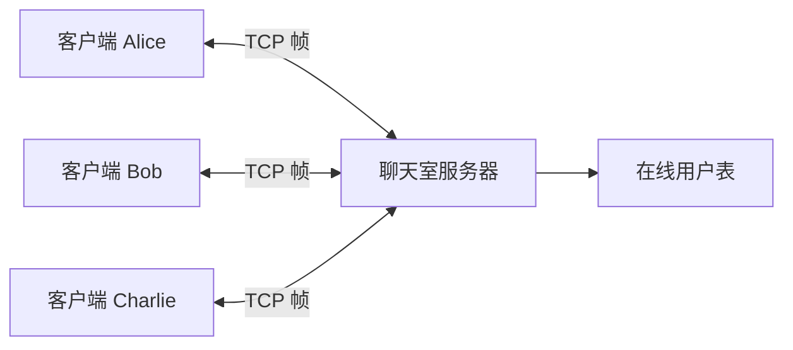
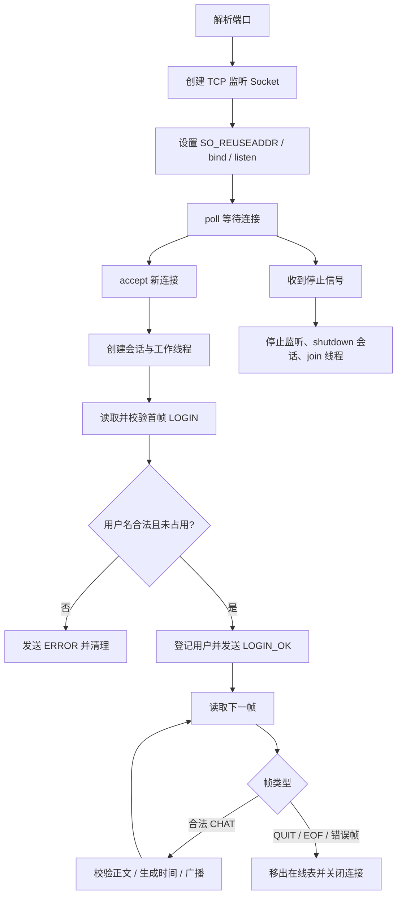
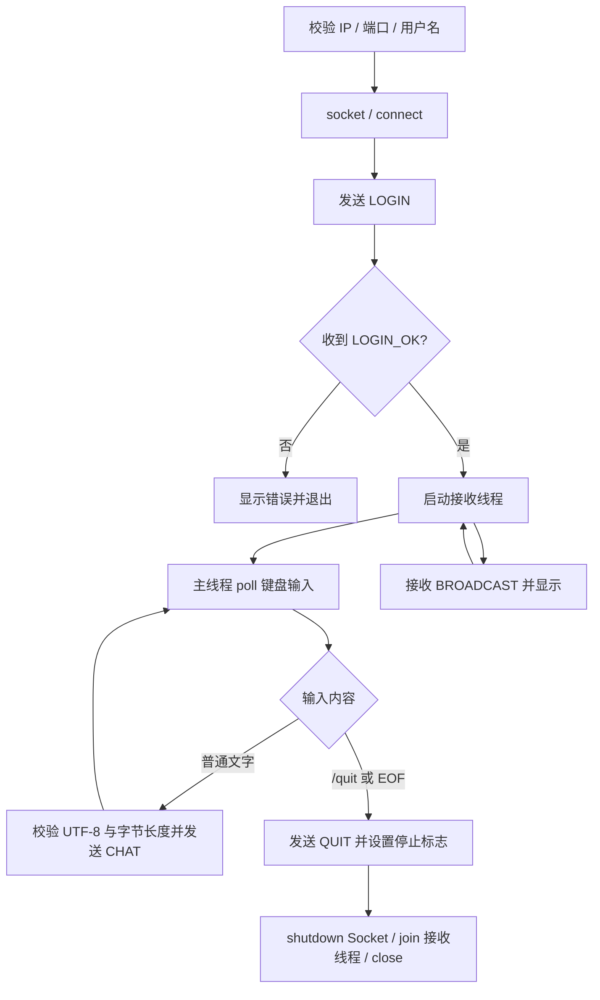

# 聊天室总体设计

## 1. 总体架构

系统采用命令行客户端/服务器结构。服务端创建 TCP 监听 Socket，使用 `accept()` 接收连接，每个客户端由一条工作线程负责登录、收帧和退出；合法聊天由服务端加上本地时间及登录用户名，再向在线连接广播。客户端主线程负责键盘输入和发送，登录成功后启动唯一的接收线程。

## 2. 文件和模块职责

| 文件 | 职责 |
| --- | --- |
| `src/protocol.h` | 消息类型、帧结构、长度上限、收发与校验接口 |
| `src/protocol.cpp` | 原生 `send()`/`recv()` 完整帧处理、UTF-8 校验、广播字段编解码 |
| `src/server.cpp` | Socket 监听、连接线程、登录状态、在线表、时间戳和广播 |
| `src/client.cpp` | 参数校验、连接登录、输入发送、接收显示与退出协调 |
| `tests/protocol_probe.py` | 外部构造拆分/合并帧和异常输入，验证服务端行为 |
| `docs/protocol.md` | 应用层协议、状态机、时序与错误行为 |
| `experiment_records/` | 实测环境、测试结论和抓包证据等报告原始资料 |
| `report/report.md` | 实验报告正文 |

## 3. 服务端流程

## 4. 客户端流程

## 5. 线程与互斥策略

- 监听线程只接受连接，不阻塞在某一客户端的聊天读取上。每个连接对应一个 `handle_client` 工作线程；连接内始终只有该线程调用 `recv_frame()`。
- `users_mutex` 只保护在线用户名到会话对象的映射。广播先复制会话快照，再释放用户表锁；网络发送期间不持有此锁。
- 每个会话的 `send_mutex` 保护 `active` 状态和整帧发送。同一客户端的多个广播不会交叉写入。Socket 最终由对应工作线程关闭；其他线程通过 `shutdown()` 唤醒读取线程。
- `broadcast_mutex` 串行化每条广播向接收者集合的分发，避免不同客户端按不同顺序观察到并发广播。
- 登录登记及发送 `LOGIN_OK` 时短暂持有会话发送锁；因此已经看到新会话的广播不能先于 `LOGIN_OK` 到达。
- 发送超时设为 3 秒。停止服务时主线程停止接受新连接、唤醒所有会话，并 `join()` 已创建的工作线程。

锁的实际嵌套顺序不跨越网络发送：在线表锁只用于查找、插入、删除或复制快照；发送锁只负责某一个连接。清理用户时先释放在线表锁，再等待会话发送锁。
