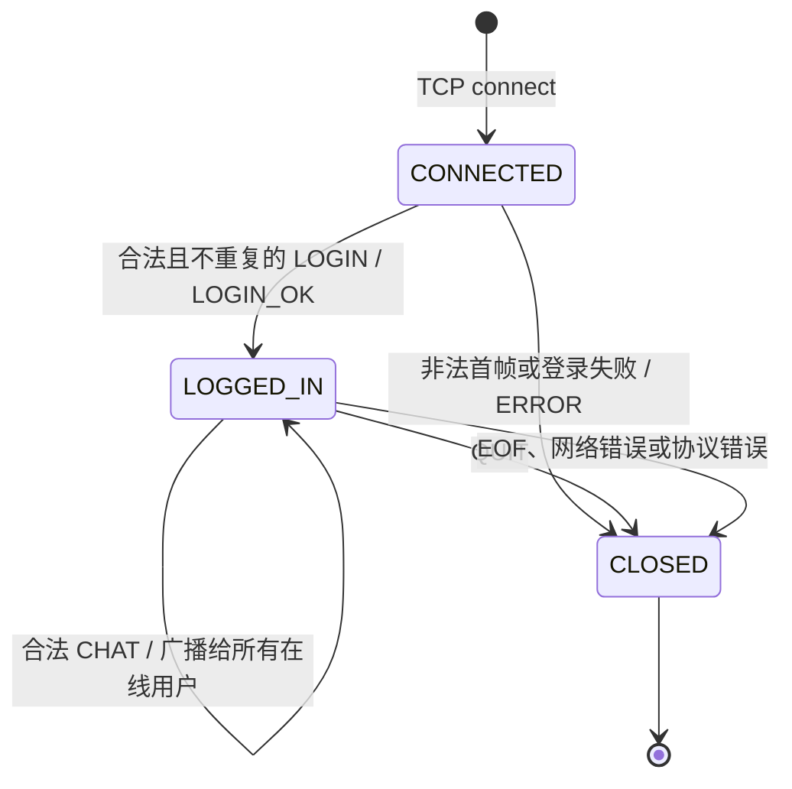
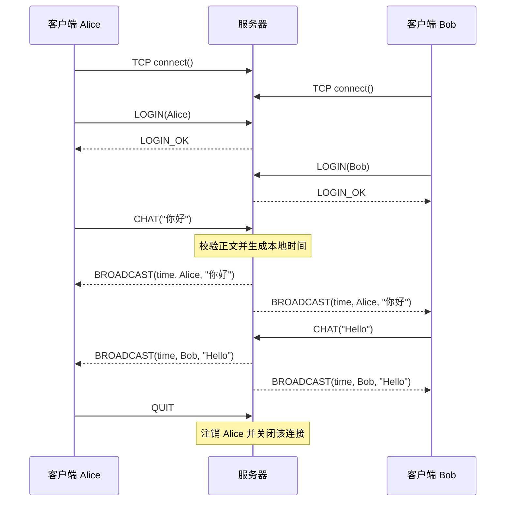

# 聊天室应用层协议

## 1. 传输与帧格式

聊天室使用 IPv4 TCP Socket。TCP 提供连续字节流，不保留应用消息边界，因此每条应用消息都使用长度前缀帧：

```text
4 字节 BodyLength（无符号 32 位大端） | 1 字节 Type | Data（变长）
```

`BodyLength = 1 + Data 的字节数`，不包含前面的 4 字节长度；范围为 `1～4096`。发送端先写入 `htonl(BodyLength)`，接收端先精确读取 4 字节并调用 `ntohl()`，检查范围后才分配帧体缓冲区。UTF-8 长度按字节计算。一次 `send()` 或 `recv()` 不对应一条消息，收发函数会循环，直到一帧完整写入或读取。

例如 `CHAT("Hello!")` 的完整帧为：

```text
00 00 00 07  03 48 65 6c 6c 6f 21
└长度 7 ┘  │  └──────── Hello! ────────┘
           CHAT
```

## 2. 消息类型

| Type | 名称 | 方向 | Data | 含义 |
| --- | --- | --- | --- | --- |
| `0x01` | `LOGIN` | 客户端 → 服务端 | UTF-8 用户名 | 请求登录；仅允许在连接后的第一帧发送 |
| `0x02` | `LOGIN_OK` | 服务端 → 客户端 | 空 | 登录成功 |
| `0x03` | `CHAT` | 客户端 → 服务端 | UTF-8 正文 | 请求向当前在线用户广播 |
| `0x04` | `BROADCAST` | 服务端 → 客户端 | 时间、用户名、正文 | 服务端生成的聊天消息 |
| `0x05` | `QUIT` | 客户端 → 服务端 | 空 | 正常离开 |
| `0x06` | `ERROR` | 服务端 → 客户端 | UTF-8 错误说明 | 请求无效；服务端随后关闭连接 |

`LOGIN_OK` 与 `QUIT` 的 `BodyLength` 必须为 1。服务器不接受客户端发送 `LOGIN_OK`、`BROADCAST` 或 `ERROR`。未知类型、错误方向或登录后重复发送 `LOGIN` 均视为协议错误。

## 3. 字段和编码约束

- 所有文本使用 UTF-8；用户名和正文都必须是合法 UTF-8。
- 用户名为 `1～32` 字节，不含 NUL、C0/C1 控制字符或换行；比较时按 UTF-8 字节串区分，允许的在线用户名不得重复。
- 聊天正文为 `1～4000` 字节，不含 NUL；命令行客户端每次发送一行，可以包含中英文和空格。
- `BROADCAST.Data` 格式为 `YYYY-MM-DD HH:MM:SS\n用户名\n正文`。时间固定为 19 个 ASCII 字节，由服务器处理 `CHAT` 时生成，采用服务端本地时间。用户名不能包含换行；解析正文时只按前两个换行切分。
- 正文上限和用户名上限保证广播帧不会超过 4096 字节。
- `ERROR` 为短 UTF-8 文本，例如 `username already in use`、`invalid message`。

中文消息示例：

```text
Type: 0x04 (BROADCAST)
Data:
2026-10-20 17:12:00
Alice
你好，Hello!
```

这里时间仅展示字段格式；运行时应使用实际服务器时间。

## 4. 连接状态与交互语义



TCP 连接成功只表示传输连接建立，不表示聊天室登录成功。用户名由第一次合法 `LOGIN` 固定；`CHAT` 不携带用户名，服务端使用该 Socket 关联的登录身份，防止客户端伪造发送者。客户端不自行显示发送成功的消息，只显示服务器广播帧。



## 5. 错误处理

| 情况 | 服务端行为 |
| --- | --- |
| 空、超长、非法 UTF-8 或重复用户名 | 尽可能发送 `ERROR`，关闭连接 |
| 未登录发送非 `LOGIN` | 发送 `ERROR`，关闭连接 |
| 非法正文、未知类型、错误方向 | 发送 `ERROR`，关闭连接 |
| `BodyLength` 为 0 或大于 4096 | 不读取负载，直接关闭 |
| 帧体中途断开 | 不处理不完整帧，清理连接 |
| `recv()` 返回 EOF 或网络错误 | 注销用户并关闭连接 |
| `send()` 失败 | 标记连接失效并 `shutdown()`；由该连接工作线程完成清理 |

`EINTR` 会重试；`recv()` 返回 0 表示对端正常关闭。部分读取不等于错误，只有完整前缀后仍未收到完整帧体时才属于截断帧。`send()` 使用 `MSG_NOSIGNAL`，避免断开的客户端触发 `SIGPIPE` 终止服务器。
