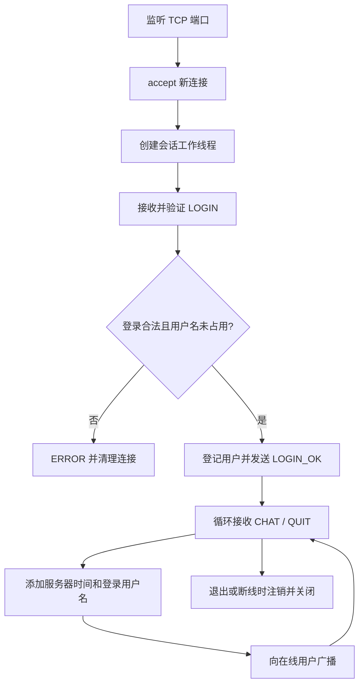

# 实验一：基于 TCP Socket 的多人聊天室

## 一、实验目的

1. 使用 POSIX 原生 TCP Socket 完成客户端与服务器通信。
2. 在 TCP 字节流上设计长度前缀应用层协议，理解读写边界与完整帧处理。
3. 使用 C++ 多线程支持实现多人连接、消息广播和客户端并发收发。
4. 验证中英文 UTF-8 通信、登录状态、异常输入及退出清理。
5. 观察实际测试中 TCP 重传计数，并说明应用层消息检查和逐包抓取的区别。

## 二、实验环境

| 项目 | 实际环境 |
| --- | --- |
| 操作系统 | Ubuntu 22.04.5 LTS / WSL2，x86_64 |
| 内核 | Linux 6.18.33.2-microsoft-standard-WSL2 |
| 编译器 | g++ 11.4.0 |
| 构建工具 | GNU Make 4.3 |
| 语言 | C++17 |
| 网络 | 同一 WSL 环境，IPv4 回环 `127.0.0.1` |
| 时区 | Asia/Shanghai，UTC+08:00 |

通过 `make clean && make` 成功构建 `server` 和 `client`，编译参数包含 `-Wall -Wextra -Wpedantic -pthread`，无编译警告。详细版本和限制记录见 [environment.md](../experiment_records/environment.md)。

## 三、需求分析与总体方案

服务器集中转发公开消息；每个 TCP 客户端连接由一个服务端工作线程维护。客户端先发送用户名登录，登录成功后，输入线程发送 `CHAT`，接收线程显示服务器返回的广播。服务器根据连接绑定的用户名生成发送者字段和本地时间，避免客户端自行伪造身份或时间。

实现范围包括公共聊天室、UTF-8、中英文聊天、多用户广播、退出和异常断开清理。系统不包含账号密码、私聊、文件传输、图形界面或数据库。

## 四、自定义聊天协议设计

每帧由 4 字节无符号大端长度、1 字节类型和变长 Data 构成。长度字段不包含自身，范围是 1～4096 字节。所有文本按 UTF-8 编码，长度按字节计算。

| Type | 消息 | 方向 | 主要字段 |
| --- | --- | --- | --- |
| `0x01` | LOGIN | 客户端 → 服务端 | 用户名，1～32 字节 |
| `0x02` | LOGIN_OK | 服务端 → 客户端 | 空 |
| `0x03` | CHAT | 客户端 → 服务端 | 正文，1～4000 字节 |
| `0x04` | BROADCAST | 服务端 → 客户端 | `时间\n用户名\n正文` |
| `0x05` | QUIT | 客户端 → 服务端 | 空 |
| `0x06` | ERROR | 服务端 → 客户端 | UTF-8 错误说明 |

`CHAT("Hello!")` 的字节示例为 `00 00 00 07 03 48 65 6c 6c 6f 21`。中文广播使用服务器本地时间 `YYYY-MM-DD HH:MM:SS`，例如 `2026-10-20 17:12:00\nAlice\n你好，Hello!`。实际运行值见测试记录。协议状态、字段和异常规则详见 [protocol.md](../docs/protocol.md)。

## 五、模块划分与程序流程

| 模块 | 职责 |
| --- | --- |
| `src/protocol.h/.cpp` | 帧编解码、完整收发、UTF-8 与广播字段校验 |
| `src/server.cpp` | 监听连接、登录、在线用户管理、广播、工作线程与退出 |
| `src/client.cpp` | 连接登录、输入发送、接收显示、客户端退出 |
| `tests/protocol_probe.py` | 构造正常及异常测试帧，记录实际结果 |

服务端主流程：



服务器使用 `users_mutex` 保护在线表；会话 `send_mutex` 保证发送整帧不交叉；`broadcast_mutex` 让所有用户按一致顺序接收并发广播。客户端在登录成功后启动单独接收线程；主线程用 `poll()` 等待键盘输入并发送。完整流程图和时序图见 [design.md](../docs/design.md)。

## 六、关键实现与运行方法

协议层的 `send_all()` 和 `recv_frame()` 对部分读写进行循环处理，遇到 `EINTR` 重试；读取长度后先验证范围，再分配帧体缓冲区。服务器为连接设置 3 秒发送超时，用 `MSG_NOSIGNAL` 避免连接关闭时触发 `SIGPIPE`。

运行方式：

```bash
make
./server 8888
./client 127.0.0.1 8888 Alice
./client 127.0.0.1 8888 Bob
./client 127.0.0.1 8888 Charlie
```

客户端输入一行文字发送，输入 `/quit` 退出；服务器按 Ctrl+C 停止。完整复现说明见 [README.md](../README.md)。

## 七、测试过程与结果

使用 `python3 tests/protocol_probe.py` 自动启动服务端并对本机回环地址运行协议测试。Python 仅用于构造测试帧和校验返回值，聊天室实现仍为 C++。

| 测试 | 实际结果 |
| --- | --- |
| 三客户端登录及广播 | Alice、Bob、Charlie 同时在线 |
| 拆分 LOGIN 写入 | LOGIN 被分 3 次 `sendall()` 写入，服务器返回 LOGIN_OK |
| 合并两条 CHAT 帧 | 一次写入两帧，三客户端按顺序收到两条，共核对 6/6 条正文 |
| 中英文 UTF-8 | Bob 的混合文本由三客户端正确接收，共核对 3/3 条 |
| 退出及重登 | Bob 退出后 Alice、Charlie 继续通信；Bob 用户名可再次登录 |
| 错误输入 | 重复/空用户名、未登录聊天、非法 UTF-8、未知类型均按预期拒绝 |
| 帧错误 | 长度 4097 被关闭；帧体未完整送达即断开时未产生聊天消息 |
| C++ 客户端 | 登录、发送并接收“client CLI 中文消息”，`/quit` 后返回状态码 0 |

上述被逐条核对的广播共 12 条：Alice 的两条消息向 3 人分发（6 条）、Bob 的一条向 3 人分发（3 条）、Bob 退出后 Charlie 向仍在线的 2 人发送（2 条）、C++ 客户端自收广播（1 条）。完整输入和观察见 [test-observations.md](../experiment_records/test-observations.md)，测试摘要见 [functional-test-results.md](../experiment_records/functional-test-results.md)，服务端日志见 [server-test.log](../experiment_records/server-test.log)。

拆分发送和合并发送验证的是应用层解析能处理不同写入节奏；TCP 可能自行合并或拆分底层数据段，因此不能仅凭 `sendall()` 次数断言实际 IP 包边界。

## 八、TCP 传输层观测与数据包丢失分析

在 Alice、重新登录的 Bob、Charlie 三条实际 TCP 连接上读取 Linux `TCP_INFO.tcpi_total_retrans`，本次分别为 `0、0、0`。此结果表示这些连接的累计 TCP 重传计数为 0；应用层测试也核对了上述 12 条广播均到达预期客户端。

尝试使用 `tcpdump -i lo` 保存 pcap 时，系统返回 `Operation not permitted`；`sudo -n tcpdump` 因当前环境需要密码而退出。因此本次没有可供 Wireshark 检查的 pcap，也没有观察 SYN/ACK、TCP 序号或逐包重传标记。不能据此声称整个网络绝无丢包；现有证据仅支持本次本机测试连接未记录 TCP 重传，且所核对的应用层广播完整。计数见 [tcp-transport-observation.md](../experiment_records/tcp-transport-observation.md)，抓包权限结果见 [capture-availability.md](../experiment_records/capture-availability.md)。

## 九、实验总结

已实现并验证基于原生 TCP Socket 的多人聊天室，完成自定义帧协议、服务器时间戳、UTF-8 多人广播、分帧/粘连处理、异常拒绝和连接清理。测试表明，在本次本机环境下，预期广播均被对应客户端正确接收，三条采样连接的 TCP 重传计数均为 0。

报告中对抓包分析的限制作了明确记录；若课程提交要求必须附 Wireshark 截图，应在拥有 `CAP_NET_RAW` 或可用 sudo 授权的 Linux 环境重新运行抓包步骤并补充实际 pcap 分析，不应把当前 TCP_INFO 计数写成逐包抓包结论。
